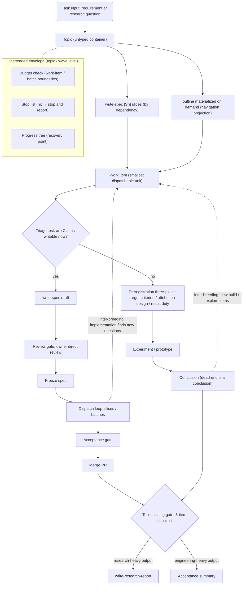
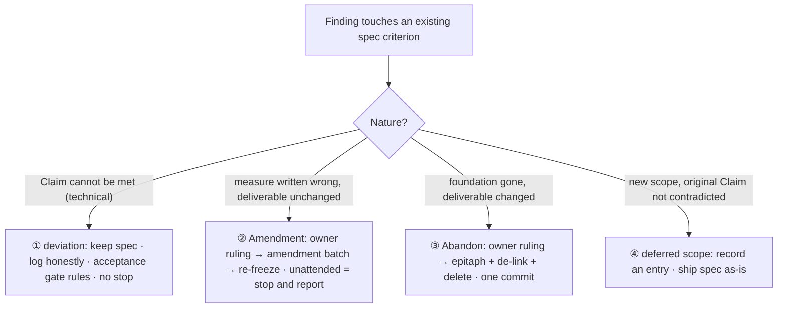
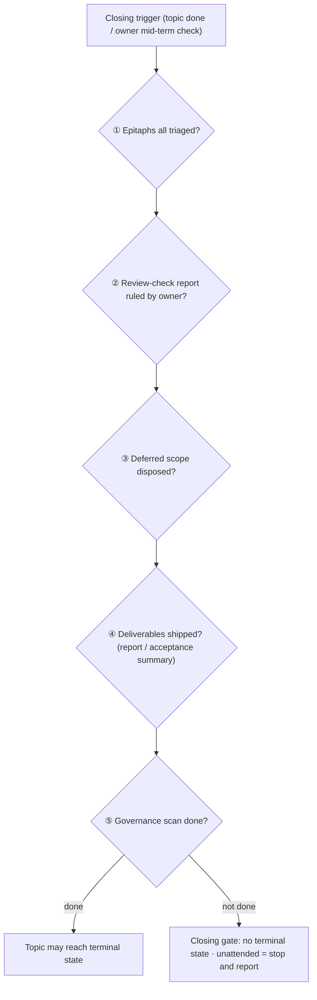
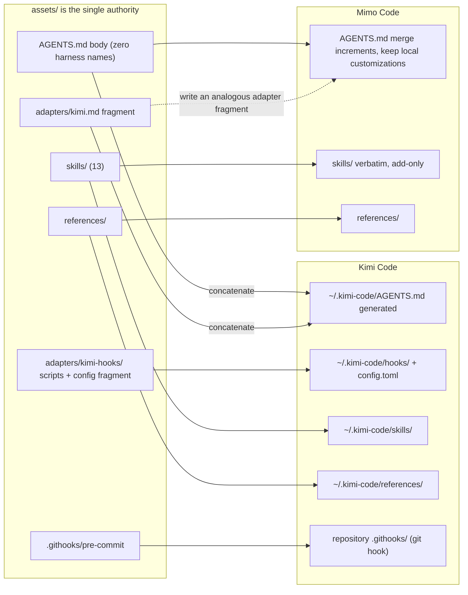

# Spec-Loop Skill Repository

A cross-device, cross-harness workflow-restoration repository carrying the spec-loop (spec-driven) engineering methodology. v2 is a single-entry loop: task input enters a topic container, each work item passes the triage test and takes the build or explore branch, the two branches inter-breed new work items, and a topic closing gate ends the run. This file explains for humans how the flow works; deployment steps, the Mimo Code merge guide, and the asset index follow. The methodology rules themselves live in `assets/AGENTS.md`.

Chinese version: [README.md](README.md)

## Language policy

The porting corpus — the harness rules body, adapters, skills, and references under `assets/` — is maintained in English, so cross-device and cross-harness copies share a single source language. `README.md` faces the repository owner and stays Chinese; `README.en.md` is its English counterpart. The full rule is in the language-policy section of [CHANGELOG.md](CHANGELOG.md).

## How the harness workflow works

The flow has one entry. A topic is an untyped container: there is no engineering / research / mixed pre-classification. Decomposition happens by work-item type: build items become `write-spec` `[Sn]` slices; explore items start with preregistration. The outline is not a second decomposition method — it is a board projection materialized when navigation needs it.



### Triage test and inter-breeding

Each work item takes the triage test on its own. Primary question: are Claims writable now — can an implementer judge right from wrong without an experiment? Yes → build; no → secondary questions: are several conclusions possible and only an experiment can tell, and is the output a deliverable or a decision basis? For demo-type capability, check whether acceptance is quantifiable up front: quantifiable (for example ≥1.3×) → build; open ("is it feasible?") → explore. The main agent rules; disagreement or a misjudgment under unattended operation stops and reports as "needs user judgment".

A misjudgment is itself a deviation, labeled `misclassification`, corrected through existing channels: judged build but the Claims were guesses and the foundation is gone → abandon + a new explore item; judged explore but the investigation converges → inter-breed a new build item. No new mechanism; log it in the decision log and the Progress tree.

Inter-breeding is a first-class mechanism: an explore conclusion "feasible / worth doing" spawns a new build item, and new questions in the conclusion spawn new explore items; a build item that finds unclear mechanisms or anomalies spawns explore items. Every new item retakes the triage test.

Explore items preregister before work starts, in three pieces: target criterion (number / condition, serving as the attribution anchor), attribution design (which result means what), result duty (a pass or a fail must both produce an attribution analysis). Revision with version traces is allowed before work starts; the preregistration freezes at start and is strong-frozen after — changing the criterion goes only through an owner ruling or abandon, never amendment. A dead end is a valid conclusion; "principle reachable but not reached this time" must be analyzed — FAIL analysis is exploration's golden output.

The outline materializes on demand, driven by structural signals: cross-session continuation, a Progress tree too coarse to navigate, an experiment that needs preregistration, or the owner asking for a board. A topic without an outline has only work items, no leaves; the board's status and conclusion lines refresh from the Progress tree and evidence records at any time, while the research question, hypotheses, leaf definitions, and preregistration criteria are its own first-hand source.

### Build branch and dispatch loop

A build work item starts with `write-spec`, which turns it into a contract: every `[Sn]` carries Claims and a boundary; the spec carries Global Constraints and Out of Scope. Before freezing it passes the review gate: the owner directly reviews the spec draft; interactive runs freeze after owner confirmation, unattended runs freeze on evidence and the owner accepts after the fact. A frozen spec is immutable; design decisions go into the companion `<slug>.decisions.md` from the start.

Dispatch runs `[Sn]` by `[Sn]`: each completed contract slice goes review → fixes → incremental re-review; mechanical slices commit on L0/L1 evidence and get a batch review at wave end. Parallel `[Sn]`s each use their own worktree and branch; the main agent serializes merges in dependency order; the main agent is the sole writer of decisions, the Progress tree, specs, and reports. Budget checks sit at work-item / batch boundaries; insufficient budget → stop and report, with the Progress tree as the recovery point. Before the whole branch opens a PR, one more whole-spec review runs as a dispatched review.

Review has no standalone role; the carrier depends on the artifact:

| Artifact | Review carrier | Independence |
|---|---|---|
| spec draft, outline skeleton, report | owner direct review | promises and direction need owner sign-off |
| subagent-written code | main agent, or dispatched review | the writer is not the judge |
| small docs and comments | main agent self pass | cost |

Dispatched review = a generic subagent + a review prompt (prompt composition: `structured-code-review`). The three-state verdict, the evidence hard requirement (prose is not evidence), and the limit of 3 consecutive rejections on one review target stay.

### Four channels for claim changes

When an explore conclusion or an implementation finding touches an existing spec criterion, route it by nature:



Criterion / promise split: changing "how it is measured" (measurement method, re-scaling, acceptance operation details) goes to ②; changing "what is delivered" (capability, scope, the goal itself) goes to ③. Preregistered criteria are strong-frozen: never ②, only an owner ruling or abandon + rewrite. The ①/② boundary cannot be judged in place; check the attribution anchor in the preregistration first: principle unreachable → ②/③; principle reachable but method or optimization fell short → ①. Any channel touching Global Constraints or Out of Scope = substantive contract change: stop and report + owner ruling, recorded at ②'s heaviest tier.

Abandon is clean disposal: after the ruling, write the epitaph (`abandoned <slug>` + reason + review condition + history pointer), de-link inbound references, delete process artifacts, all in one commit — into history first, out of the workspace second. Research reports are never deleted; superseded decision entries stay alive with a marker.

Vocabulary map: stop-list terms ↔ channels — deviation = ①, deferred scope = ④, contract error = ②/③ (substantive change, stop and report).

### Topic closing gate

The closing gate is an orchestration checkpoint, not a skill; all five items must pass before a topic may reach terminal state:



An unattended run that reaches the end with an unchecked list stops and reports; never "close now, fix later". Item ① is graded when the epitaph is written: knowledge-class → a rejected DR kept long-term; situational → check the review condition and prompt the owner when it has changed. Every closing action yields evidence pointers (triaged N, promoted DRs, cleared N, triggered N, scan scope and candidate count); prose is not evidence. Item ② is a strong action: deliver the review-check report (changed-condition list + proposed disposal) to the owner and close only after the ruling. Item ⑤ forces the scan, not the cleanup: run the `simplification-audit` six-question quick pass (or confirm no candidates), record candidates in MDR entries, and do not block closing — zero candidates is evidence too. For long topics the owner may trigger a mid-term check; the topic stays open. Closing outputs follow the actual mix: research-heavy → `write-research-report`; engineering-heavy → acceptance summary.

### Unattended envelope and stop list

The envelope hangs at the topic / wave level, checked at every work-item and batch boundary: if the budget cannot cover the remaining work → stop and report; the Progress tree guarantees recovery after an interruption; never degrade quality to keep running. Fix blockers only; record suggestions and report them, do not chase. A review target rejected 3 times in a row → stop; a green light resets the count; deviations do not count. Three consecutive failures on one objective → dispatch a read-only advisor.

Stop list (hit → stop and report): history rewrite (including force-push), secret leak, needs user judgment, substantive spec change, real regression red, budget exhausted, merge conflict, environment / CI unavailable, review consecutive rejections at the limit, tool permission denied.

Four easily confused boundaries: deferred scope is not a substantive change (log and keep going); a contract error is (stop); a Claims deviation is neither (record it, finish the rest, hand it to the acceptance gate; un-ruled = needs user judgment); a new-test red is not a real regression red (its own counter; 3 consecutive red rounds in one slice → stop; only green-turning-red stops at once).

### Acceptance gate

Before merge, the acceptance gate re-checks two lists: the claims-deviation list and the deferred-scope list, reported with evidence. Both live in the PR description (`pr-description`) and are ruled on by the main agent and the owner; deviations are ruled by the gate, not by the review carrier. Merge precondition = review verdict approve + evidence.

This is the understanding layer; the methodology rules — main loop, channel procedures, closing gate, unattended parameters, the full stop list, GitHub Flow — live in `assets/AGENTS.md` (installed as `~/.kimi-code/AGENTS.md`); this README does not restate them.

## Skill collaboration

13 skills in four layers: scene entries do the writing (contract / board / explanation), record governance owns record structure and the decision lifecycle, the action layer owns expression, leakage, review, and simplification, and the process-execution layer owns push, PR, merge, and test reliability. Edges show collaboration, ownership, and citation direction; each rule has exactly one owner and is cited elsewhere, never restated.

```mermaid
flowchart TB
    subgraph ENTRY["Scene entry layer"]
        WS["write-spec: contract writing"]
        WRO["write-research-outline: board + preregistration"]
        WRR["write-research-report: explanatory writing"]
    end
    subgraph REC["Record governance layer"]
        RD["record-discipline: source/projection + budgets"]
        MDR["manage-decision-records: decision lifecycle"]
    end
    subgraph ACT["Action layer"]
        PQ["prose-quality: expression standard"]
        TCL["trim-cot-leakage: leakage repair"]
        SCR["structured-code-review: review methodology"]
        SA["simplification-audit: architecture simplification"]
    end
    subgraph FLOW["Process-execution layer"]
        PPC["pre-push-checks: push gatekeeping"]
        PRD["pr-description: PR narrative"]
        MST["merge-stack: merge landing"]
        TR["test-reliability: test reliability"]
    end
    subgraph AST["Non-skill assets"]
        AG["assets/AGENTS.md: orchestration hub"]
        REF["assets/references: style + workflow depth"]
        AD["assets/adapters: model mapping + install layout"]
    end

    AG -->|"spec leaf handed over"| WS
    AG -->|"explore item → preregistration"| WRO
    WRO -->|"conclusion outgrows one line → deep dive"| WRR
    WRR -.->|"suggestions return as new leaves"| WRO
    WRO -->|"knowledge promotion → rejected"| MDR
    WS -->|"decisions / epitaphs / amendments as D-xx"| MDR
    WS -->|"Progress tree / pointer references"| RD
    WRO -->|"leaf conclusions are projections"| RD
    WRR -->|"data references and budgets"| RD
    MDR -->|"supersession is the only revision style"| RD
    SA -->|"retention judgment + proposed format"| MDR
    SA -->|"lifecycle / concurrency vocabulary"| SCR
    SCR -->|"Layer 1 first item"| PQ
    SCR -->|"Layer 1 first item"| TCL
    TCL -->|"cites proposition rules before deleting"| PQ
    WS -->|"spec and log prose"| PQ
    WRO -->|"outline prose"| PQ
    WRR -->|"report prose"| PQ
    SA -->|"proposal prose"| PQ
    PPC -->|"tiered gate selection"| REF
    PRD -->|"acceptance lists for reconciliation"| AG
    MST -->|"merge precondition approve"| AG
    TR -->|"reliability criteria"| SCR
    PPC -.->|"change concurrent tests via TR first"| TR
    SCR -->|"Declared style conformance"| REF
    AG -->|"language → style index"| REF
    AD -->|"sole home of model mapping"| AG
```



Reading the layers:

- Scene entries: `write-spec` takes build work items and freezes contracts; `write-research-outline` materializes the board on demand and owns preregistration; `write-research-report` consumes leaf state only and returns suggestions as new leaves.
- Record governance: `manage-decision-records` owns the entry format, the Progress-tree format, epitaphs, and the closing batch; `record-discipline` owns source/projection, budgets, and refresh — open a ticket before writing, verify after writing, batch-check at closing.
- Action layer: `prose-quality` and `trim-cot-leakage` are the expression and leakage standards; `structured-code-review` is the review methodology (Layer 1 invokes the first two); `simplification-audit` produces simplification proposals and delegates retention judgment to governance.
- Process execution: `pre-push-checks` selects the minimal check set for the change surface; `pr-description` supplies the acceptance lists; `merge-stack` owns dependency order and fix propagation; `test-reliability` supplies reliability criteria.
- Non-skill assets: `assets/AGENTS.md` is the always-loaded orchestration and ownership hub; `assets/references/` holds depth for style, testing, and GitHub Flow; `assets/adapters/` holds harness increments only and is the sole home of model mapping and install layout.

## How to optimize an AI workflow

Each gate answers a typical AI-workflow failure; the table aligns pain points, mechanisms, and where they live:

| AI workflow pain point | Mechanism | Where it lives |
|---|---|---|
| A wrong contract freezes and the whole run drifts | Owner direct review of the spec draft before freezing; interactive runs freeze after confirmation, unattended runs freeze on evidence and the owner accepts after the fact | `write-spec`, the main-loop overview figure |
| An unattended run has no gatekeeper | Budget checks + fix blockers only + 3-rejection limit + advisor after 3 failures + serious-risk stop list | `assets/AGENTS.md` unattended envelope and stop list |
| Mechanical changes burn review rounds | Slice triage: contract slices reviewed one by one; mechanical slices commit on L0/L1 evidence and get a batch review at wave end | `assets/AGENTS.md` build branch, `assets/references/workflow/testing.md` |
| Red and green tests are confused, or tests are flaky | L0–L3 layering + a separate new-test-red counter + `test-reliability` topology and resource discipline | `assets/references/workflow/testing.md`, `test-reliability` |
| Review degenerates into a self-review rubber stamp | Three carriers split by artifact; for subagent code the writer is not the judge; no evidence, no approve | `assets/AGENTS.md` review mechanism, `structured-code-review` |
| Records are written many times, boards drift, artifacts balloon | Source/projection split by content unit, one-sentence projections with pointers, soft caps and refresh duties; the Progress tree is the single progress source | `record-discipline`, `manage-decision-records` |
| AI prose leaks session traces | `prose-quality` complete propositions + `trim-cot-leakage` 8-class detection, as review Layer 1's first item | `prose-quality`, `trim-cot-leakage` |
| Decisions get lost or rules drift | Decision Log + standalone DR three states + supersession as the only revision style + one rule, one owner | `manage-decision-records`, `write-spec` |
| Governance starves | Topic-closing item ⑤ fixes the governance scan; recording candidates does not block closing | `simplification-audit`, the topic closing gate |
| New work interrupts the current implementation | Deferred scope (④) as a first-class exit + inter-breeding: record the entry and ship the spec as-is, or spawn a new work item | `write-spec`, the four-channels figure |

## What each file is for

| File | Reader | Role |
|---|---|---|
| `README.md` | Humans | Chinese walkthrough of the workflow |
| `README.en.md` | Humans | The same content in English (this file) |
| `CHANGELOG.md` | Humans | Version changes and the reasoning behind them (including language policy) |
| `AGENTS.md` (repository root) | Agents on this machine | Deployment and maintenance manual; local file, not tracked |
| `assets/**` | Harnesses and agents | Porting assets: rules body, adapters, skills, references |

## Directory layout

```
.
├── README.md                # Chinese walkthrough of the workflow
├── README.en.md             # This file: the same content in English
├── CHANGELOG.md             # Version changes and their reasoning
├── AGENTS.md                # Local file, not tracked: deployment and maintenance manual
├── .githooks/
│   └── pre-commit           # R3: git hook running L0 (git config core.hooksPath .githooks)
├── .gitignore
└── assets/                  # Porting assets (maintained in English)
    ├── AGENTS.md            # Rules body (zero harness names)
    ├── adapters/
    │   ├── kimi.md          # Kimi Code increment fragment (## Harness adapter)
    │   └── kimi-hooks/      # R1/R2 Node scripts + config.toml [[hooks]] fragment
    ├── skills/              # Thirteen skills, each with a SKILL.md (see catalog below)
    └── references/          # style/{python,engineering,error-handling}.md; workflow/{github-flow,testing}.md
```

## Skill catalog

| Skill | Layer | Owns | Trigger |
|---|---|---|---|
| `write-spec` | Scene entry | Contract writing: `[Sn]` / Claims, freeze, After-freeze change semantics | Build work item starts; amendment / abandon / deferred handling |
| `write-research-outline` | Scene entry | Board writing (on demand), preregistration, dual-speed registration | Outline materialization; lightweight registration; before experiments |
| `write-research-report` | Scene entry | Explanatory writing: three timed reports (stage / overall / deep-dive) | Leaf batches terminal; topic closing; owner asks |
| `manage-decision-records` | Record governance | Decision governance, epitaphs, Progress-tree format, closing batch | Adding / revising decisions; amendment bookkeeping; closing triage |
| `record-discipline` | Record governance | Record structure discipline: source/projection, budgets, refresh (ticket / verify / batch-check) | Before writing any record; review; closing; source change |
| `prose-quality` | Action | Expression standard: complete propositions, coverage duties, de-duplication | Always: writing / reviewing / fixing / trimming any prose |
| `trim-cot-leakage` | Action | Session-leakage detection and repair: 8-class taxonomy | Reviewing or fixing prose |
| `structured-code-review` | Action | Review methodology: two layers, evidence, dispatched-review prompt composition | Self pass; PR / diff / task-output review |
| `simplification-audit` | Action | Architecture simplification: delete maintenance obligations (6 questions, three-way classification) | User request; stage-exit routine (closing item ⑤) |
| `pre-push-checks` | Process execution | Push gatekeeping: minimal check set for the change surface, out with evidence | Before push / ready / claiming checks pass |
| `pr-description` | Process execution | PR narrative: four sections + acceptance minimums (both lists) | Creating a PR; description drift after review rounds |
| `merge-stack` | Process execution | Merge landing: dependency order, fix the introducing layer first, fix propagation | Merging PRs / stacked slices |
| `test-reliability` | Process execution | Test reliability: execution topology, atomic resources, isolation and teardown | New / modified concurrency- or resource-heavy tests; flaky diagnosis |

Each skill's full rules live in its `assets/skills/<name>/SKILL.md`; this table covers ownership and triggers only.

## Deployment

The repository's root `AGENTS.md` is local and not tracked, so the deployment commands are collected here for anyone reading the repository on GitHub. Installation is **synthesis**, not a whole-file copy: `assets/AGENTS.md` is the body with zero harness names, `assets/adapters/kimi.md` is the increment fragment (it carries its own `## Harness adapter` heading), and concatenating the two generates the live file — the live file is never hand-maintained.

The figure maps the assets onto the two harnesses' install locations:



### Kimi Code

```sh
mkdir -p ~/.kimi-code/skills ~/.kimi-code/references ~/.kimi-code/hooks
{ cat assets/AGENTS.md; echo; cat assets/adapters/kimi.md; } > ~/.kimi-code/AGENTS.md
for s in assets/skills/*/; do
  n=$(basename "$s")
  mkdir -p ~/.kimi-code/skills/"$n"
  cp -r "$s/." ~/.kimi-code/skills/"$n"/
done
cp -r assets/references/. ~/.kimi-code/references/
cp assets/adapters/kimi-hooks/*.mjs ~/.kimi-code/hooks/
```

Merge the two `[[hooks]]` entries from `assets/adapters/kimi-hooks/config.toml` into `~/.kimi-code/config.toml`. Hooks are optional fail-open guardrails; a harness without hooks is fully covered by the rule layer and the flow still runs. The three starter hooks divide the work: R1 blocks force-push, `--no-verify`, rebase, and reset --hard; R2 reminds the agent to leave with evidence before `git push`; R3 is the L0 floor in the pre-commit hook.

The git hook is a repository asset: `.githooks/pre-commit` runs L0 (the L0 definition is in `assets/references/workflow/testing.md`); enable it in a repository with `git config core.hooksPath .githooks`. When a repository has no `scripts/run-l0`, the hook prints a notice and lets the commit through.

Maintenance contract:

- The repository is the single authority; `~/.kimi-code/AGENTS.md` is generated (body + fragment). Re-concatenate after changing either source; never edit the live file.
- Skill sync is add-only; delete a retired skill directory in the target by hand.
- Model mapping and install layout live only in the adapter fragment; the body carries zero harness names.
- Relative paths inside the rules file (such as `references/style/python.md`) refer to installed locations under `~/.kimi-code/references/...`.

Verify the install; the script prints only what is missing:

```sh
n=$(find ~/.kimi-code/skills -mindepth 1 -maxdepth 1 -type d 2>/dev/null | wc -l); [ "$n" -eq 13 ] || echo "skill count: $n, expected 13"
for s in ~/.kimi-code/skills/*/; do [ -s "$s/SKILL.md" ] || echo "missing: $s/SKILL.md"; done
[ -s ~/.kimi-code/AGENTS.md ] || echo "missing: AGENTS.md"
grep -q '^## Harness adapter' ~/.kimi-code/AGENTS.md || echo "missing: harness adapter section"
diff -q <( { cat assets/AGENTS.md; echo; cat assets/adapters/kimi.md; } ) ~/.kimi-code/AGENTS.md || echo "drift: AGENTS.md is not body + adapter"
[ -s ~/.kimi-code/hooks/block-dangerous-git.mjs ] || echo "missing: hooks/block-dangerous-git.mjs"
[ -s ~/.kimi-code/hooks/push-evidence-reminder.mjs ] || echo "missing: hooks/push-evidence-reminder.mjs"
grep -q 'block-dangerous-git.mjs' ~/.kimi-code/config.toml || echo "missing: [[hooks]] entries in config.toml"
for f in style/python.md style/engineering.md style/error-handling.md workflow/github-flow.md workflow/testing.md; do
  [ -s ~/.kimi-code/references/"$f" ] || echo "missing: references/$f"
done
```

### Mimo Code

Mimo Code's skill-directory layout differs, and its global rules file needs merge increments; there is no standalone agent role file — review runs through the three carriers (owner direct, main agent / dispatched review, small-prose self pass). `skills.paths` in `~/.config/mimocode/mimocode.jsonc` must include `~/.config/mimocode/skills`.

#### Skill sync (add-only)

The sync only adds; it never removes other skills from the global directory:

```sh
for s in assets/skills/*/; do
  n=$(basename "$s")
  mkdir -p ~/.config/mimocode/skills/"$n"
  cp -r "$s/." ~/.config/mimocode/skills/"$n"/
done
```

#### References sync

```sh
mkdir -p ~/.config/mimocode/references
cp -r assets/references/. ~/.config/mimocode/references/
```

#### Merging AGENTS.md

`diff` the repository's `assets/AGENTS.md` against `~/.config/mimocode/AGENTS.md` first. Keep the mimo-local customizations as they are (compose wiring, personal skill entries, `model_groups` tiers); merge only the repository's increments — the main loop, the four claim-change channels, the topic closing gate, the unattended envelope and stop list, the review mechanism, GitHub Flow, and the coding rules — rather than overwriting the whole file. Model mapping does not go into the body: write an analogous Mimo fragment (`assets/adapters/<harness>.md`, a `## Harness adapter` section) carrying the model-tier mapping and install layout, and inject it during the merge. The repository does not contain the mimo main-agent prompt; it is out of restore scope.

#### Verification

```sh
for s in assets/skills/*/; do diff -q "$s/SKILL.md" ~/.config/mimocode/skills/$(basename "$s")/SKILL.md; done
for f in assets/references/*/*.md; do rel=${f#assets/references/}; diff -q "$f" ~/.config/mimocode/references/"$rel"; done
```

## Version history

Version changes and the reasoning behind them are recorded in [CHANGELOG.md](CHANGELOG.md), organized by version; when restoring a given version, that version's entry defines the layout and behavior.

## Other harnesses

Installation for another harness is the same synthesis: install the `assets/AGENTS.md` body as that harness's always-loaded rules file, then write an `assets/adapters/<harness>.md` fragment for it (starting with `## Harness adapter: <name>`, increments only: capability mapping, model tiers, install layout, optional hooks) and concatenate it at install time. The bodies of `assets/skills/*/SKILL.md` and `assets/references/` are harness-agnostic and install verbatim; a harness without hooks still runs the full flow, because the rule layer does not depend on hooks.
