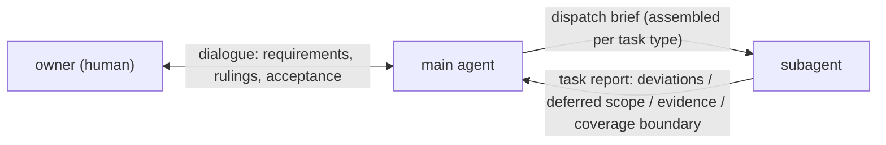
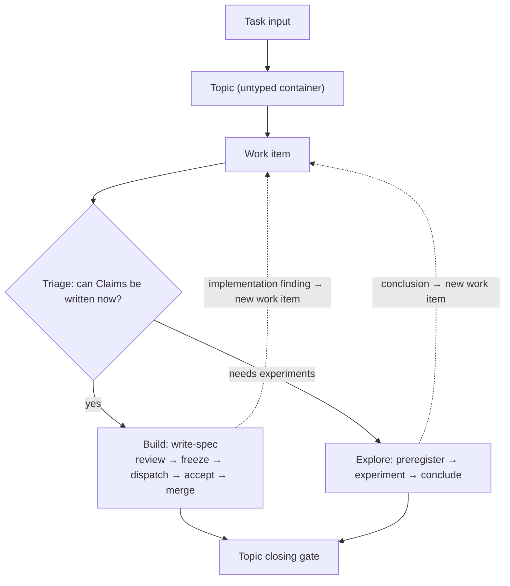
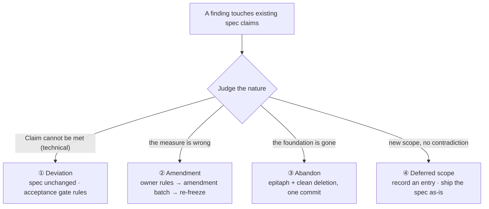
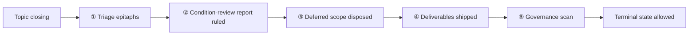
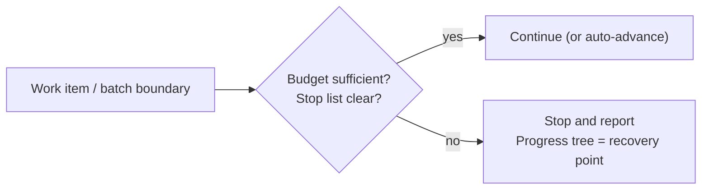
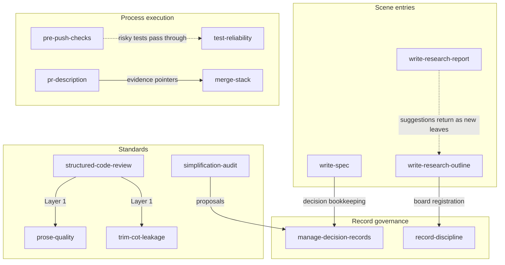
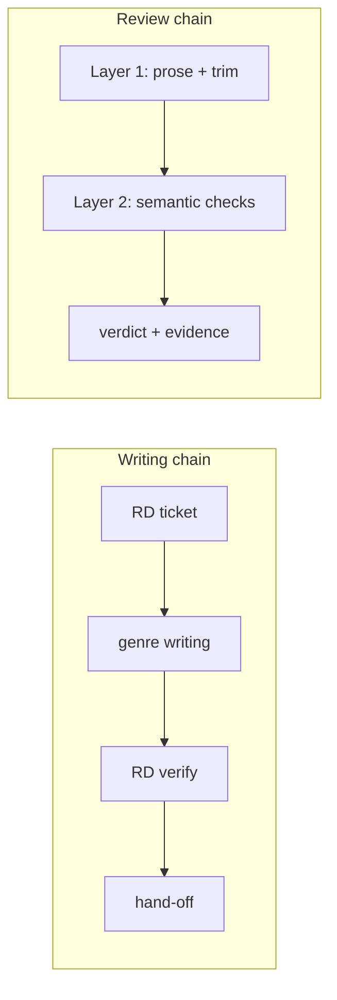
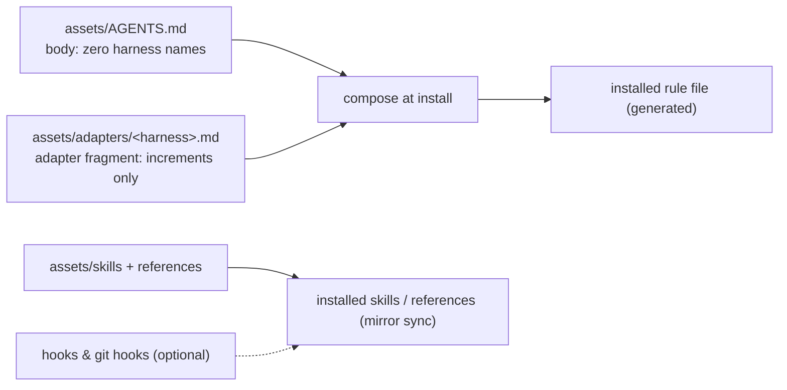

# Spec-Loop Skill

A methodology for **collaborating with AI on research and engineering work**: the owner sets direction and rules at gates, the main agent decomposes, dispatches, and accepts, and subagents implement — packaged as a rule set and skill corpus that ports across devices and harnesses.

中文版: [README.md](README.md)

## Design philosophy

### Division of labor: three roles, one dialogue line



- **Owner (human)**: sets direction and requirements, and rules at the key gates — spec freeze, amendment/abandon, acceptance, topic closing.
- **Main agent**: talks with the human, understands requirements, decomposes work, dispatches, reviews, and accepts; the **sole writer** of decisions, progress, contracts, and reports. Applies small fixes directly; resumes the implementing subagent for large ones.
- **Subagent**: implements the dispatched task (bulk code or prose) and returns a task report; never writes contract or decision artifacts.

### Six core ideas

1. **Single entry + triage test** — no "engineering vs research" split up front. Each work item gets one question: "Can the Claims be written now?" Yes (writable = every value has a source — measurement, standard, requirement; a predicted value is a hidden preregistration) → build, through a spec contract; only experiments can tell → explore, through preregistration.
2. **Mutual generation** — exploration findings spawn build items; implementation anomalies spawn explore items. "Testing while exploring" needs no track switch, only new work items.
3. **Four channels for claim changes** — a frozen spec is not dead: deviation (contract unchanged), Amendment (the measure changes), Abandon (foundation gone, cleanly deleted), deferred scope (new scope recorded elsewhere), each with a controlled exit.
4. **One source, many projections** — the same fact appearing in several artifacts serves several readers and is not the disease; unspecified copying is. Each fact has one authoritative home; every other appearance is a one-line projection, and projections of projections are forbidden.
5. **Preregistration = attribution anchor** — freeze the target criterion and attribution design before an exploratory experiment; only then do "met" and "missed" carry causal meaning. FAIL analysis is exploration's most valuable output.
6. **Progressive disclosure + four enforcement layers** — rules load in three tiers on demand (always-loaded rule file → event-loaded skills → references for depth); enforcement is layered: mechanical interception > process structure (gates/checklists) > rule text > role discipline.

### The main loop



### Four channels for claim changes



### Topic closing gate



All five must pass before a topic may close (under unattended operation, failure = stop and report). Item ⑤ forces the scan, not the resolution — governance candidates are recorded and never block closing.

### Unattended envelope and safety net

Long unattended runs hang at the topic level, backed by a four-part safety net:

- **Budget checkpoints**: at every work-item / batch boundary, compare remaining budget against remaining work; stop and report when short — never lower the gates to keep running.
- **Stop list**: history rewrite, secret leak, needs-user-judgment, substantive spec change, real regression red … hit any one and stop + report.
- **Recovery point**: the Progress tree is the only progress truth — one line per node, grep-able state words, updated at every work-item boundary; resume a broken session from it.
- **Rejection cap and advisor**: three consecutive rejections of one review target stop the run; three consecutive failures on one objective dispatch a read-only advisor (the consultation and its disposition are logged as a decision entry).



## The skill set (13, in four layers)



**Scene entries** — three kinds of writing:

| Skill | Owns | Trigger |
|---|---|---|
| `write-spec` | Contract writing: `[Sn]`/Claims, freeze, after-freeze change procedures | A build work item starts; amendment / abandon / deferred handling |
| `write-research-outline` | Board writing (materialized on demand), preregistration, dual-speed registration | Board materialization; lightweight registration; before experiments |
| `write-research-report` | Explanatory writing: stage / overall / deep-dive reports | Leaf batches terminal; topic closing; owner asks |

**Record governance** — putting "one source, many projections" into practice:

| Skill | Owns | Trigger |
|---|---|---|
| `manage-decision-records` | Decision governance: entry and Progress-tree format, supersession, epitaphs, closing batch | Adding/revising decisions; amendment bookkeeping; closing triage |
| `record-discipline` | Record structure discipline: source/projection, budgets, ticket / verify / batch programs | Before writing any record; review; closing; source change |

**Standards** — expression and review:

| Skill | Owns | Trigger |
|---|---|---|
| `prose-quality` | Editorial standard: complete propositions, required coverage, no redundancy | Always (writing/reviewing/fixing/trimming any prose) |
| `trim-cot-leakage` | Session-leakage detection and repair (8-class taxonomy) | Reviewing / fixing prose |
| `structured-code-review` | Two-layer review methodology, evidence rules, dispatch-review prompt composition | Self pass; PR / diff / task-output review |
| `simplification-audit` | Architecture simplification: delete maintenance obligations | Owner request; topic-closing governance scan |

**Process execution** — engineering-action gatekeeping:

| Skill | Owns | Trigger |
|---|---|---|
| `pre-push-checks` | Push gatekeeping: minimal check set per change surface, evidence out the door | Before push / marking ready |
| `pr-description` | PR narrative (four sections) + acceptance minimums (two lists) | Creating / updating a PR |
| `merge-stack` | Merge landing: dependency order, fix propagation, merge-only | Merging PRs / stacked slices |
| `test-reliability` | Test reliability: topology modeling, atomic resources, isolation and teardown | Concurrency/resource-heavy tests; flaky diagnosis |

## How the skills collaborate



- **Writing chain**: `record-discipline` tickets every unit before writing (belong? where? how big? source?) → the artifact skill's genre writing → RD verification → hand-off. High-frequency outline updates ride the light path (registration completes immediately).
- **Review chain**: `structured-code-review` is the single methodology — Layer 1 runs `prose-quality` + `trim-cot-leakage` first, Layer 2 applies semantic checks per change surface. Carriers as needed: owner direct review of documents, main agent review of subagent code (writer ≠ reviewer), or a dispatched review. Evidence is mandatory: **prose is not evidence**.
- **Change chain**: a finding touching claims → the four channels → Amendment / Abandon bookkeeping and epitaphs live in `manage-decision-records`; de-linking pointers is `trim-cot-leakage`'s.
- **Quality-gate chain**: risky tests pass `test-reliability` design criteria → `pre-push-checks` selects evidence before push → `pr-description` records the two lists → `merge-stack` lands with approve + evidence. Engineering red lines: merge-only, never rebase / force-push, never `--no-verify`; a post-merge rollback is an owner-ruled revert commit (history moves forward; the lesson lands in the redo's spec).
- **Governance cross-cut**: `simplification-audit` runs the governance scan at topic closing (candidates recorded, never blocking), and its proposals use `manage-decision-records` formats and retention judgment; once the standalone corpus crosses a growth threshold, the scan raises a knowledge-base pruning for the owner to rule on.

## Adapting to your harness

The corpus itself is harness-agnostic. Harnesses differ only in a few lines of text (capability mapping, model-pool rules, install paths), kept in an **adapter fragment** and composed at install time — the installed rule file is a **generated artifact, never hand-maintained**.



### 1. Compose the rule file

```sh
mkdir -p ~/.<harness>/
{ cat assets/AGENTS.md; echo; cat assets/adapters/<harness>.md; } > ~/.<harness>/AGENTS.md
```

### 2. Place skills and references (mirror sync)

```sh
cp -r assets/skills/*     ~/.<harness>/skills/
cp -r assets/references/* ~/.<harness>/references/
```

The sync is a mirror: the repository is authoritative — besides overwriting, a re-sync deletes whatever the repository no longer carries (`diff -rq` shows the residue); files that never came from the repository stay.

- **Kimi Code**: target `~/.kimi-code/`, fragment `assets/adapters/kimi.md`.
- **Mimo Code**: target `~/.config/mimocode/` (copy each skill into its own directory and register the path in `skills.paths` of `mimocode.jsonc`); diff the global AGENTS.md and merge increments rather than overwriting the file, keeping mimo-local wiring and model-tier concepts; model selection follows mimo's native `model` fields.

### 3. Hooks and git hooks (optional)

Hooks are fail-open guardrails against slips: **the rule layer stands complete on any harness without hooks** — the methodology does not depend on them. The three hooks are abstract guardrails; the contract below (authoritative definition: "Hook contract" in `assets/references/workflow/github-flow.md`) lets any harness implement them against its own extension points:

| hook | trigger point | action | guards | failure mode | required capability |
|---|---|---|---|---|---|
| R1 dangerous-command guard | before a shell or git command executes | block commands in the danger set (force-push, rebase, `reset --hard`, `--no-verify`) | merge-only red line; stop-list "history rewrite" | fail-open | pre-command hook |
| R2 push-evidence reminder | before a push | non-blocking reminder of the evidence requirement | "prose is not evidence"; `pre-push-checks` | fail-open | pre-push hook |
| R3 L0 floor | git `pre-commit` | run the product's `scripts/run-l0` (L0 tiers: `references/workflow/testing.md`) | the L0 mechanical floor | no L0 defined → skip with a loud warning | git hooks |

Kimi Code reference implementations live in `assets/adapters/kimi-hooks/`; R3 is plain git — this repository's `.githooks/pre-commit` can be copied as-is (the product must define its own `scripts/run-l0`):

```sh
cp assets/adapters/kimi-hooks/*.mjs ~/.kimi-code/hooks/   # R1 / R2
cp .githooks/pre-commit <your-product-repo>/.githooks/    # R3
git config core.hooksPath .githooks
```

Merge the `[[hooks]]` blocks from R1/R2 into `~/.kimi-code/config.toml`.

### Verify

```sh
{ cat assets/AGENTS.md; echo; cat assets/adapters/<harness>.md; } | diff -q - ~/.<harness>/AGENTS.md || echo "stale: re-run step 1"
find ~/.<harness>/skills -mindepth 1 -maxdepth 1 -type d | wc -l   # expect 13
```

## Repository layout

| Path | Role |
|---|---|
| `assets/AGENTS.md` | The rule body (harness-agnostic; half of the composed file) |
| `assets/adapters/` | One adapter fragment per harness + optional hook scripts |
| `assets/skills/` | 13 skills, one directory with one `SKILL.md` each |
| `assets/references/` | `style/` (style, engineering principles, error handling) and `workflow/` (test method, GitHub Flow) |
| `.githooks/` | R3 pre-commit hook reference implementation (plain git, portable to any harness) |
| `README.md` / `README.en.md` | The bilingual front page (this file) |
| `CHANGELOG.md` | Version changes and rationale (incl. the language policy) |

The corpus (`assets/`) is maintained in English — one source language keeps cross-device diffs stable; `README.md` is Chinese, `README.en.md` English. Full language policy: [CHANGELOG.md](CHANGELOG.md).

## Versions and rationale

What each version changed, why, and which alternatives were rejected — all recorded in [CHANGELOG.md](CHANGELOG.md).
