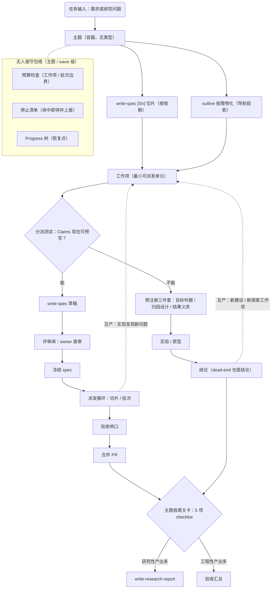
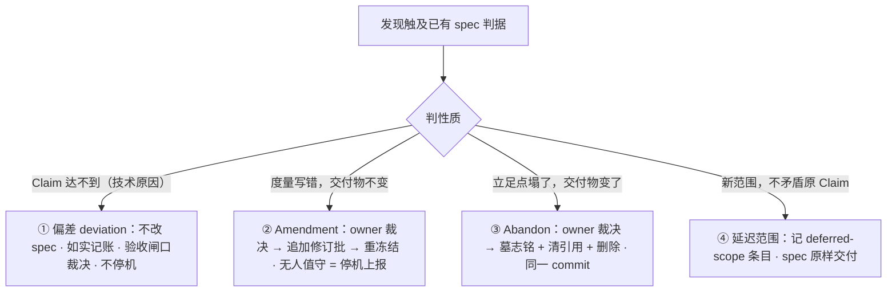
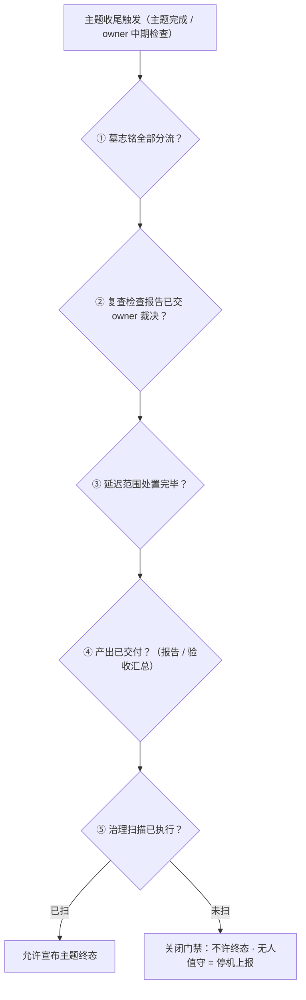
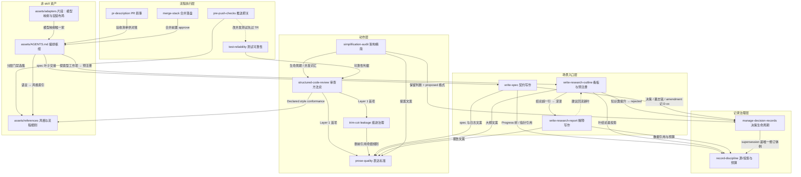
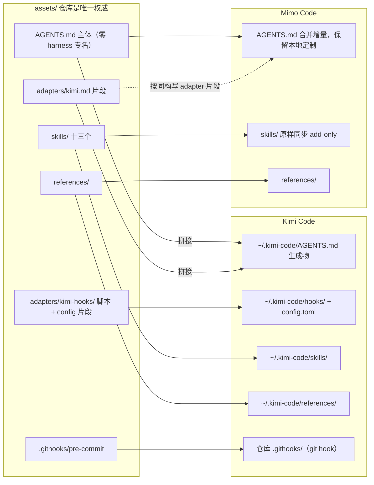

# Spec-Loop Skill 仓库

跨设备、跨 harness 的工作流恢复仓库：承载 spec-loop（规格驱动）工程方法论。v2 是单入口循环——任务输入进主题容器，工作项过分流测试后走建设或探索分支，两支互产新工作项，最后由主题收尾关卡关门。本文件面向人，解释这套流程如何运转；部署步骤、Mimo Code 合并指引与资产索引在下文，方法论细则以 `assets/AGENTS.md` 为准。

English version: [README.en.md](README.en.md)

## 语言策略

移植语料（`assets/` 下的 harness 规则主体、adapters、skills、references）以英文维护，跨设备、跨 harness 拷贝时只有一种源语言；`README.md` 面向仓库 owner，保持中文，`README.en.md` 是它的英文对等版本。完整规则见 [CHANGELOG.md](CHANGELOG.md) 的语言政策一节。

## harness 流程如何工作

流程只有一个入口。主题（topic）是无类型容器，不预设“工程/研究/混合”；分解按工作项类型发生：建设工作项写成 `write-spec` 的 `[Sn]` 切片，探索工作项先登记预注册。大纲（outline）不是第二种分解法，而是按导航需求物化的看板投影。



### 分流测试与互产

每个工作项单独过分流测试。主问：Claims 现在可预写吗——实现者不做实验就能判对错？能 → 建设型；不能 → 再看辅问：结论是否多种可能且须实验才知、产出是交付物还是决策依据。演示型能力看验收标准能否预先量化：可量化（如 ≥1.3×）走建设，开放（“可行吗”）走探索。判定权在主 agent；分歧或无人值守判错按“需要用户判断”停机上报。

判错本身是偏差的一种，标签 `misclassification`，纠正走既有通道：误判建设型 → Claims 是猜的、立足点塌了 → abandon + 新探索工作项；误判探索型 → 调查收敛 → 互产新建设工作项。不新增机制，记账进决策日志与 Progress 树。

互产是一等机制：探索结论“可行/值得做”产出新建设工作项，结论里的新疑问产出新探索工作项；建设实现中发现机制不明或反常，同样产出探索工作项。每个新工作项重新过分流测试。

探索分支先预注册再开工，三件套：目标判据（数字/条件，充当归因锚）、归因设计（什么结果说明什么）、结果义务（达标/未达都必须产出归因分析）。开工前可版本化修订，开工即冻结，冻结后强冻结——改判据只走 owner 裁决或 abandon，不适用 amendment。dead-end 是正当结论；“原理可达而本次未达”必须分析，FAIL 分析是探索的黄金产出。

大纲按需物化，触发信号是结构性的：跨会话续跑、Progress 树粗到不便导航、出现实验需预注册、owner 明确要看板。没有大纲的主题只有工作项，没有叶子；大纲的状态与结论行可随时从 Progress 树与证据记录刷新，研究问题、假设、叶子定义与预注册判据则是它自己的一手源。

### 建设分支与派发循环

建设工作项先由 `write-spec` 写成契约：每个 `[Sn]` 带 Claims 与边界，spec 级带 Global Constraints 与 Out of Scope。冻结前过评审闸：spec 草稿由 owner 直审；交互式运行由 owner 确认后冻结，无人值守凭证据自动冻结、事后由 owner 验收补认。冻结后的 spec 不可变，设计决策从开工起记入配套 `<slug>.decisions.md`。

派发按 `[Sn]` 进行：契约切片每完成一片走审查 → 修复 → 增量复审；机械切片凭 L0/L1 证据提交，wave 末批量审查。并行 `[Sn]` 各用独立 worktree 与分支，合并由主 agent 按依赖序串行执行；决策、Progress 树、spec 与报告只有主 agent 一个写者。预算检查点在工作项/批次边界，不足即停跑上报，Progress 树是恢复点。整分支开 PR 前再做一次全量审查，走派发审。

审查没有独立角色，按工件选择承载方式：

| 工件 | 审查承载 | 独立性来源 |
|---|---|---|
| spec 草稿、大纲骨架、报告 | owner 直审 | 承诺与方向要 owner 认账 |
| subagent 写的代码 | 主 agent 审，或派发审 | 写者 ≠ 审者 |
| 小文档与注释 | 主 agent 自审 pass | 成本考量 |

派发审 = 通用 subagent + 审查 prompt（prompt 构成归 `structured-code-review`）。三态 verdict、证据硬要求（prose 不是证据）、同一评审对象连续 3 次拒绝上限保留。

### 判据变更四通道

探索结论或实现发现触及已有 spec 判据时，按性质走四条通道之一：



口径/承诺二分：改“怎么量”（度量方法、数值重标定、验收操作细节）走 ②；改“交付什么”（能力、范围、目标本身）走 ③。预注册判据适用强冻结，不适用 ②，只能 owner 裁决或 abandon 重写。①/② 的边界不能就地判，先查预注册里的归因锚：原理不可达 → ②/③；原理可达但方法或优化未达标 → ①。任何通道触及 Global Constraints 或 Out of Scope = 契约实质变化，停机上报 + owner 裁决，记录走 ② 最重档。

Abandon 是干净处置：裁决放弃后写墓志铭（`abandoned <slug>` + 理由 + 复查条件 + 历史指针），清 inbound 引用，删除过程工件，以上全部进同一个 commit——先入历史、后删工作区。研究报告不删；被 supersession 的决策条目加标注留活。

词汇映射防漂移：停止清单三词 ↔ 四通道——偏差 = ①、延迟范围 = ④、契约错 = ②/③（实质变化，停机上报）。

### 主题收尾关卡

主题收尾是编排关卡，不是 skill；五项全过才允许宣布主题终态：



无人值守跑到终点而 checklist 未过 = 停机上报，不允许“先关了回头补”。第 ① 项在墓志铭写入时即分级：知识类提升为 rejected DR 长期保留，情境类检查复查条件、条件已变提示 owner 裁决。每项收尾动作留下证据指针（分流几条、提升哪些 DR、清几条、触发几条、扫描范围与候选数），prose 不是证据。第 ② 项是强动作：向 owner 交复查检查报告（条件已变清单 + 建议处置），owner 裁决后才许关门。第 ⑤ 项门禁强制“扫了”不强制“清完”：过 `simplification-audit` 六问快筛（或确认无候选），候选记 MDR 条目即可、不阻塞关闭，0 候选也是证据。超长主题由 owner 主动触发中期检查，不关主题。产出按实际构成定：研究性多 → `write-research-report`；工程性多 → 验收汇总。

### 无人值守包络与停止清单

无人值守挂在主题/wave 层，检查点在每个工作项与批次边界：预算不足以覆盖剩余工作 → 停跑上报，Progress 树保证中断后可恢复；绝不降质硬跑。只修阻断项，建议记录后上报、不追。同一评审对象连续 3 次拒绝 → 停；绿灯清零；偏差不算拒绝。同一目标连续 3 次失败 → 派只读 advisor。

停止清单（命中即停并上报）：历史改写（含 force-push）、密钥泄露、需要用户判断、实质 spec 变更、真实回归红、预算耗尽、合并冲突、环境/CI 不可用、评审连续拒绝达上限、工具权限被拒。

四类易混边界：延迟范围不是实质变更（记账继续）；契约写错是实质变更（停）；Claims 偏差既不是延迟范围也不是契约错（记录、完成其余部分、交验收闸口裁决，未裁决 = 需要用户判断）；新写的测试红不是真实回归红（独立计数器，同一切片连续 3 轮红停机，由绿转红才立即停）。

### 验收闸口

合并前，验收闸口复核两份清单：Claims 偏差清单与延迟范围清单，连同证据一起上报。两份清单存放在 PR 描述里（`pr-description`），由主 agent 与 owner 共同裁决；偏差归闸口裁决，不由审查承载方裁断。合并前置条件 = 审查 verdict 为 approve 且有证据。

以上是理解层概述；方法论细则——主循环、四通道程序、收尾关卡、无人值守参数、停止清单全文、GitHub Flow——以 `assets/AGENTS.md` 为准（安装后即 `~/.kimi-code/AGENTS.md`），本 README 不复述。

## Skill 联动

13 个 skill 分四层：场景入口负责写作（契约/看板/解释），记录治理管记录结构与决策生命周期，动作层管表达、痕迹、审查与精简，流程执行层管推送、PR、合并与测试可靠性。边表示协作、归属与引用方向；每条规则只有一个 owner，别处只引用不复述。



分层读法：

- 场景入口：`write-spec` 收建设型工作项并冻结契约；`write-research-outline` 按需物化看板并管预注册；`write-research-report` 只消费叶子状态出报告，建议回流为新叶。
- 记录治理：`manage-decision-records` 管条目格式、Progress 树格式、墓志铭与收尾批处理；`record-discipline` 管源/投影、预算与刷新——写前开票、写后验票、收尾批查。
- 动作层：`prose-quality` 与 `trim-cot-leakage` 是表达与痕迹标准，`structured-code-review` 是审查方法论（Layer 1 调前两者），`simplification-audit` 产简化提案、留存判断委托治理层。
- 流程执行：`pre-push-checks` 按改动面选最小检查集，`pr-description` 供验收两份清单，`merge-stack` 管依赖序与修复传播，`test-reliability` 供可靠性判据。
- 非 skill 资产：`assets/AGENTS.md` 是恒载编排与归属枢纽；`assets/references/` 是风格、测试与 GitHub Flow 的深潜；`assets/adapters/` 只放 harness 增量，是模型映射与安装布局的唯一家。

## 如何优化 AI 工作流程

每个闸口对应一类 AI 工作流的典型失效，下表把痛点、机制与落点对齐：

| AI 工作流痛点 | 机制 | 落点 |
|---|---|---|
| 错误契约冻结后整轮跑偏 | 冻结前 owner 直审 spec 草稿；交互式确认后冻结，无人值守凭证据自动冻结、事后补认 | `write-spec`、主循环总览图 |
| 无人值守时没有把关 | 预算检查 + 只修阻断项 + 3 次拒绝上限 + 3 次失败派 advisor + 严重风险停止清单 | `assets/AGENTS.md` 无人值守包络与停止清单 |
| 机械改动烧掉审查轮次 | 切片分流：契约切片逐片审查，机械切片凭 L0/L1 证据、wave 末批量审查 | `assets/AGENTS.md` 建设分支、`assets/references/workflow/testing.md` |
| 测试红绿不分或 flaky | L0–L3 分层 + 新测试红独立计数器 + `test-reliability` 的拓扑与资源纪律 | `assets/references/workflow/testing.md`、`test-reliability` |
| 审查退化成自审橡皮图章 | 三种承载按工件分工，subagent 代码写者 ≠ 审者；无证据不放行 | `assets/AGENTS.md` 审查机制、`structured-code-review` |
| 记录多倍写、看板漂移、无界膨胀 | 源/投影按内容单元二分，投影单句 + 指针，软上限与刷新义务；Progress 树是唯一进度真相源 | `record-discipline`、`manage-decision-records` |
| AI 文案泄漏会话痕迹 | `prose-quality` 完整命题 + `trim-cot-leakage` 8 类检测，作为审查 Layer 1 首项 | `prose-quality`、`trim-cot-leakage` |
| 决策丢失或规则漂移 | Decision Log + standalone DR 三态 + supersession 唯一修订 + 一规则一归属 | `manage-decision-records`、`write-spec` |
| 治理容易饿死 | 主题收尾第 ⑤ 项固定触发治理扫描，候选记账不阻塞关闭 | `simplification-audit`、主题收尾关卡 |
| 新工作打断当前实现 | 延迟范围（④）一等出口 + 互产：新范围记条目、spec 原样交付，或生成新工作项 | `write-spec`、判据变更四通道图 |

## 文件分工

| 文件 | 读者 | 职能 |
|---|---|---|
| `README.md` | 人 | 中文流程理解（本文件） |
| `README.en.md` | 人 | 同一内容的英文版 |
| `CHANGELOG.md` | 人 | 版本变更说明和理由（含语言政策） |
| `AGENTS.md`（仓库根） | 本机 agent | 部署与维护手册；本地文件，不入库 |
| `assets/**` | 各 harness 与 agent | 移植资产：规则主体、adapters、skills、references |

## 目录结构

```
.
├── README.md                # 本文件：中文，流程理解（人读）
├── README.en.md             # 英文版：同一内容
├── CHANGELOG.md             # 版本变更说明和理由
├── AGENTS.md                # 本地文件，不入库：本机部署与维护手册
├── .githooks/
│   └── pre-commit           # R3：git hook 跑 L0（git config core.hooksPath .githooks）
├── .gitignore
└── assets/                  # 移植资产（英文维护）
    ├── AGENTS.md            # 规则主体（零 harness 专名）
    ├── adapters/
    │   ├── kimi.md          # Kimi Code 增量片段（## Harness adapter）
    │   └── kimi-hooks/      # R1/R2 Node 脚本 + config.toml [[hooks]] 片段
    ├── skills/              # 十三个 skill，各含 SKILL.md（见下方分工表）
    └── references/          # style/{python,engineering,error-handling}.md；workflow/{github-flow,testing}.md
```

## Skill 分工

| Skill | 层 | 职责 | 触发时机 |
|---|---|---|---|
| `write-spec` | 场景入口 | 契约写作：`[Sn]`/Claims、冻结、After freeze 变更语义 | 建设工作项开工；amendment / abandon / 延迟范围处置 |
| `write-research-outline` | 场景入口 | 看板写作（按需物化）、预注册、双速登记 | 大纲物化时刻；轻量登记；实验前 |
| `write-research-report` | 场景入口 | 解释写作：三种时点报告（阶段/总体/深潜） | 叶子批次终态；主题收尾；owner 索要 |
| `manage-decision-records` | 记录治理 | 决策治理、墓志铭、Progress 树格式、收尾批处理 | 增改决策；amendment 记账；收尾分流 |
| `record-discipline` | 记录治理 | 记账结构纪律：源/投影、预算、刷新（开票/验票/批查） | 写任何记录前；审查；收尾；源变更 |
| `prose-quality` | 动作 | 表达标准：命题完整、覆盖义务、去冗余 | 恒在：写/审/修/剪任何文字 |
| `trim-cot-leakage` | 动作 | 会话泄漏检测与修复：8 类分类法 | 审阅或修复文案 |
| `structured-code-review` | 动作 | 审查方法论：两层、证据、派发审 prompt 构成 | 自审 pass；PR/diff/任务产出审查 |
| `simplification-audit` | 动作 | 架构精简：删维护义务（6 问、三分法） | 用户要求；阶段出口例行（收尾第 ⑤ 项） |
| `pre-push-checks` | 流程执行 | 推送把关：按改动面选最小检查集并带证据出门 | push / 标记 ready / 声称检查通过前 |
| `pr-description` | 流程执行 | PR 叙事：四节 + 验收最低项（两份清单） | 创建 PR；审查轮后描述失真 |
| `merge-stack` | 流程执行 | 合并落盘：依赖序、先修引入层、修复传播 | 合并 PR / 切片栈 |
| `test-reliability` | 流程执行 | 测试可靠性：执行拓扑、原子资源、隔离与 teardown | 新增/修改并发·资源型测试；诊断 flaky |

每个 skill 的完整规则在其 `assets/skills/<name>/SKILL.md`；本表只给分工与触发。

## 部署

根 `AGENTS.md` 是本地文件、不入库，因此部署命令收录在这里，GitHub 读者照此恢复即可。安装是**合成**，不是整文件拷贝：`assets/AGENTS.md` 是零 harness 专名的主体，`assets/adapters/kimi.md` 是增量片段（自带 `## Harness adapter` 节标题），两者拼接生成实机文件——实机文件不手维护。

下图是资产到两个 harness 的安装映射：



### Kimi Code

```sh
mkdir -p ~/.kimi-code/skills ~/.kimi-code/references ~/.kimi-code/hooks
{ cat assets/AGENTS.md; echo; cat assets/adapters/kimi.md; } > ~/.kimi-code/AGENTS.md
for s in assets/skills/*/; do
  n=$(basename "$s")
  mkdir -p ~/.kimi-code/skills/"$n"
  cp -r "$s/." ~/.kimi-code/skills/"$n"/
done
cp -r assets/references/. ~/.kimi-code/references/
cp assets/adapters/kimi-hooks/*.mjs ~/.kimi-code/hooks/
```

把 `assets/adapters/kimi-hooks/config.toml` 的两条 `[[hooks]]` 条目并入 `~/.kimi-code/config.toml`。hooks 是可选的防手滑护栏（fail-open）；没有 hooks 的 harness 由规则层完整兜底，流程照常运行。三条起步 hook 分工：R1 拦截 force-push、`--no-verify`、rebase 与 reset --hard；R2 在 `git push` 前提醒带证据出门；R3 是 pre-commit 里的 L0 下限。

git hook 是仓库资产：`.githooks/pre-commit` 跑 L0（L0 定义见 `assets/references/workflow/testing.md`），在仓库里启用 `git config core.hooksPath .githooks`；仓库没有 `scripts/run-l0` 时，hook 打印提示并放行。

维护契约：

- 仓库是唯一权威；`~/.kimi-code/AGENTS.md` 是生成物（主体 + 片段），改任一来源后重新拼接，实机不手改。
- skill 同步只增不删，目标端退役的 skill 目录需手工删除。
- 模型映射与安装布局只写在 adapter 片段里；主体不得出现 harness 专名。
- 规则文件内的相对路径（如 `references/style/python.md`）指安装后的 `~/.kimi-code/references/...`。

校验安装，脚本只打印缺失项：

```sh
n=$(find ~/.kimi-code/skills -mindepth 1 -maxdepth 1 -type d 2>/dev/null | wc -l); [ "$n" -eq 13 ] || echo "skill count: $n, expected 13"
for s in ~/.kimi-code/skills/*/; do [ -s "$s/SKILL.md" ] || echo "missing: $s/SKILL.md"; done
[ -s ~/.kimi-code/AGENTS.md ] || echo "missing: AGENTS.md"
grep -q '^## Harness adapter' ~/.kimi-code/AGENTS.md || echo "missing: harness adapter section"
diff -q <( { cat assets/AGENTS.md; echo; cat assets/adapters/kimi.md; } ) ~/.kimi-code/AGENTS.md || echo "drift: AGENTS.md is not body + adapter"
[ -s ~/.kimi-code/hooks/block-dangerous-git.mjs ] || echo "missing: hooks/block-dangerous-git.mjs"
[ -s ~/.kimi-code/hooks/push-evidence-reminder.mjs ] || echo "missing: hooks/push-evidence-reminder.mjs"
grep -q 'block-dangerous-git.mjs' ~/.kimi-code/config.toml || echo "missing: [[hooks]] entries in config.toml"
for f in style/python.md style/engineering.md style/error-handling.md workflow/github-flow.md workflow/testing.md; do
  [ -s ~/.kimi-code/references/"$f" ] || echo "missing: references/$f"
done
```

### Mimo Code

Mimo Code 的 skill 目录布局不同，全局规则文件需要合并增量；不存在独立的 agent 角色文件，审查靠 owner 直审、主 agent 审/派发审与小文档自审三种承载。`~/.config/mimocode/mimocode.jsonc` 的 `skills.paths` 需包含 `~/.config/mimocode/skills`。

#### skill 同步（add-only）

同步只增不删，不清理全局目录中的其他 skill：

```sh
for s in assets/skills/*/; do
  n=$(basename "$s")
  mkdir -p ~/.config/mimocode/skills/"$n"
  cp -r "$s/." ~/.config/mimocode/skills/"$n"/
done
```

#### references 同步

```sh
mkdir -p ~/.config/mimocode/references
cp -r assets/references/. ~/.config/mimocode/references/
```

#### AGENTS.md 合并

先 `diff` 仓库的 `assets/AGENTS.md` 与 `~/.config/mimocode/AGENTS.md`；mimo 本地定制（compose 接线、个人 skill 条目、`model_groups` 档位）原样保留，只把仓库增量——主循环、判据变更四通道、主题收尾关卡、无人值守包络与停止清单、审查机制、GitHub Flow、编码规则——合并进去，不整文件覆盖。模型映射不写进主体：按 `assets/adapters/kimi.md` 同构补一份 Mimo 片段（`assets/adapters/<harness>.md`，`## Harness adapter` 节），承载模型档位映射与安装布局，合并时一并注入。本仓库不含 mimo 主 agent 提示词，不在恢复范围内。

#### 校验

```sh
for s in assets/skills/*/; do diff -q "$s/SKILL.md" ~/.config/mimocode/skills/$(basename "$s")/SKILL.md; done
for f in assets/references/*/*.md; do rel=${f#assets/references/}; diff -q "$f" ~/.config/mimocode/references/"$rel"; done
```

## 版本历史

版本变更说明和理由记录在 [CHANGELOG.md](CHANGELOG.md)，按版本组织；恢复某一版本的资产时，以该版本条目描述的布局与行为为准。

## 其他 harness

其他 harness 的安装同样是合成：把 `assets/AGENTS.md` 主体装到该 harness 的恒载规则文件，再为它写一份 `assets/adapters/<harness>.md` 片段（以 `## Harness adapter: <name>` 开头，只放增量：能力映射、模型档位、安装布局、可选 hooks），安装时拼接进去。`assets/skills/*/SKILL.md` 与 `assets/references/` 正文与 harness 无关，原样安装；没有 hooks 也可以完整运行，规则层不依赖 hooks。
