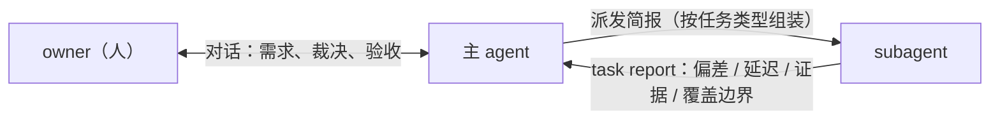
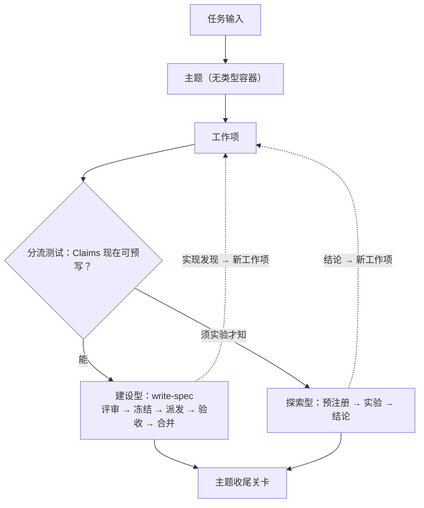
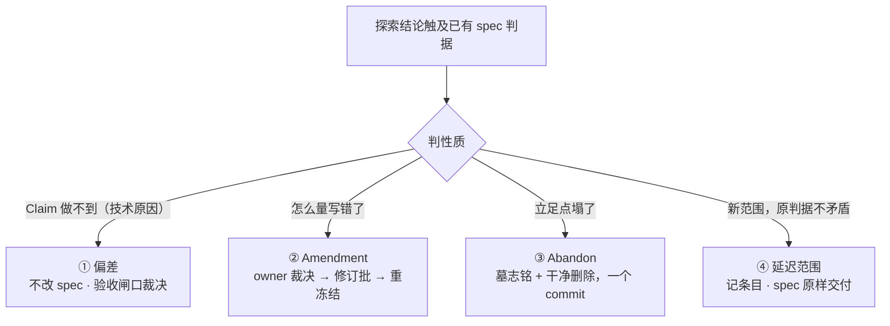
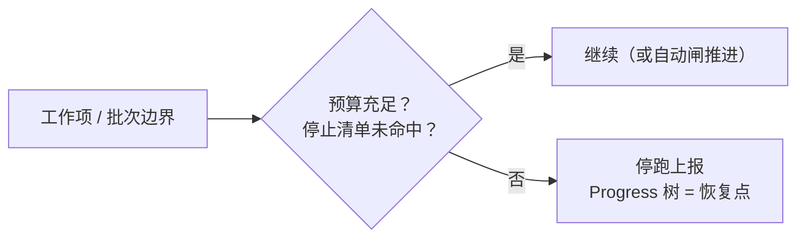
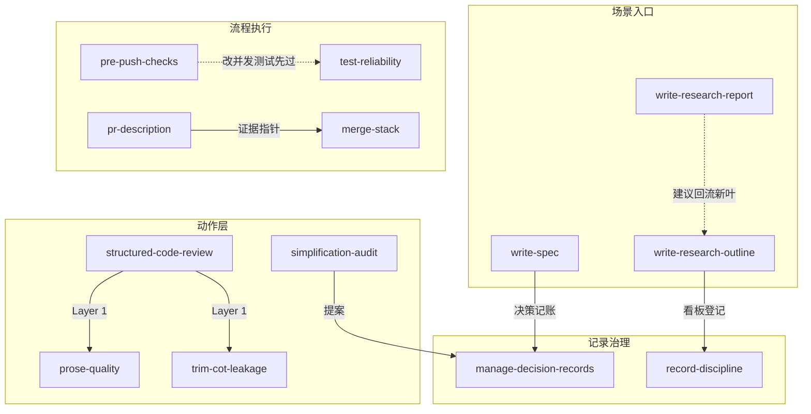
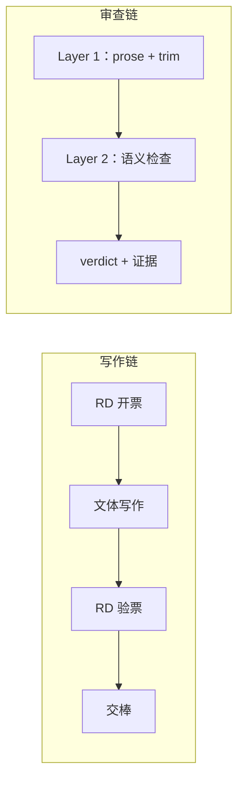
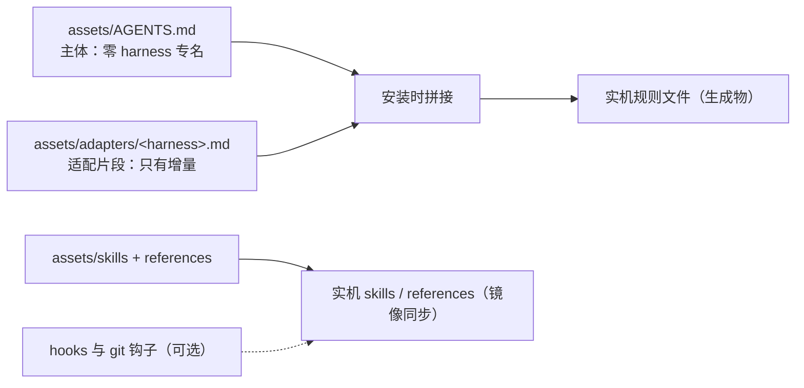

# Spec-Loop Skill

一套**与 AI 协作完成研究与工程任务**的方法论：人定方向与裁决，主 agent 拆解、派发、验收，subagent 实现任务——配一套可跨设备、跨 harness 移植的规则与 skill 语料。

English version: [README.en.md](README.en.md)

## 设计理念

### 分工：三种角色，一条对话主线



- **owner（人）**：定方向、给需求，在关键闸口裁决——spec 冻结、amendment/abandon、验收、主题收尾。
- **主 agent**：与人对话、理解需求、拆解任务、派发、审查与验收；决策、进度、契约、报告的**唯一写者**。少量修复亲自改，大量修复 resume 原 subagent 继续。
- **subagent**：实现主 agent 派发的任务（大量代码或成篇文字），交付 task report；不写契约与决策工件。

### 六条核心观念

1. **单入口 + 分流测试**——任务不分"工程/研究"。每个工作项单独问一句"Claims 现在可预写吗？"：能（可预写 = 数值有出处——实测 / 标准 / 需求；预测值 = 隐藏预注册）→ 建设型，走 spec 契约；须实验才知 → 探索型，走预注册。
2. **互产循环**——探索结论生成新建设项，实现反常生成新探索项。"边测试边探索"不需要换轨，只需要不断生成新工作项。
3. **判据变更四通道**——冻结的 spec 不是死的：偏差（不改契约）、Amendment（改度量）、Abandon（立足点塌，干净删除）、延迟范围（新范围另记），各有受控出口。
4. **一源多投影**——同一事实多处出现是多读者需求，不是病；病在无规格的复制。每条事实一个权威家，其余位置只放一行投影，且禁止投影的投影。
5. **预注册 = 归因锚**——探索型实验先冻结目标判据与归因设计，"达到/未达"才有因果解释力；FAIL 分析是探索的黄金产出。
6. **渐进式披露 + 强制力四层**——规则分三层按需加载（恒载规则文件 → 事件加载 skill → 引用深潜 references）；强制力分层布置：机械拦截 > 流程结构（闸口/checklist）> 规则文本 > 角色自觉。

### 主循环全景



### 判据变更四通道



### 主题收尾关卡


五项全过才许关门（无人值守未过 = 停机上报）；第 ⑤ 项门禁强制"扫了"不强制"清完"——治理候选记账即可，不阻塞关闭。

### 无人值守与安全网

长跑（无人值守）挂在主题层，四件安全网兜底：

- **预算检查点**：每个工作项 / 批次边界核对剩余预算，不够就停跑上报——绝不降门禁硬跑。
- **停止清单**：改历史、泄密、需用户判断、契约实质变化、真实回归红……命中即停 + 上报。
- **恢复点**：Progress 树是唯一进度真相——一行一节点、状态词可 grep、每个工作项边界必更新，会话中断后从这里续跑。
- **拒绝上限与顾问**：同一评审对象 3 连拒即停；同一目标 3 连败派只读顾问（咨询与处置记一条决策条目）。



## Skill 集（13 个，四层）



**场景入口**——三类写作：

| skill | 职责 | 触发 |
|---|---|---|
| `write-spec` | 契约写作：`[Sn]`/Claims、冻结、After-freeze 变更程序 | 建设型工作项开工；amendment / abandon / 延迟处置 |
| `write-research-outline` | 看板写作（按需物化）、实验预注册、双速登记 | 大纲物化；轻登记；实验前 |
| `write-research-report` | 解释写作：阶段 / 总体 / 深潜三种报告 | 叶子批次终态；主题收尾；owner 索要 |

**记录治理**——"一源多投影"的落地：

| skill | 职责 | 触发 |
|---|---|---|
| `manage-decision-records` | 决策治理：条目与 Progress 树格式、supersession、墓志铭、收尾批处理 | 增改决策；amendment 记账；收尾分流 |
| `record-discipline` | 记账结构纪律：源/投影、预算、开票 / 验票 / 批查三程序 | 写任何记录前；审查；收尾；源变更 |

**动作层**——表达与审查标准：

| skill | 职责 | 触发 |
|---|---|---|
| `prose-quality` | 表达标准：完整命题、覆盖义务、去冗余 | 恒在（写/审/修/剪任何文字） |
| `trim-cot-leakage` | 会话痕迹泄漏检测修复（8 类分类） | 审查 / 修复文案 |
| `structured-code-review` | 两层审查方法论、证据要求、派发审 prompt 构成 | 自审 pass；PR / diff / 任务产出 |
| `simplification-audit` | 架构精简：删除维护义务 | owner 要求；主题收尾治理扫描 |

**流程执行**——工程动作把关：

| skill | 职责 | 触发 |
|---|---|---|
| `pre-push-checks` | 推送把关：按改动面选最小检查集，带证据出门 | push / 标记 ready 前 |
| `pr-description` | PR 叙事四节 + 验收最低项（两份清单） | 创建 / 更新 PR |
| `merge-stack` | 合并落盘：依赖序、修复传播、merge-only | 合并 PR / 切片栈 |
| `test-reliability` | 测试可靠性：拓扑建模、原子资源、隔离与 teardown | 并发/资源型测试；flaky 诊断 |

## 如何协作



- **写作链**：动笔前 `record-discipline` 开票（放不放 / 放哪 / 多大 / 源在哪）→ 工件 skill 文体写作 → RD 验票 → 交棒；大纲高频登记走轻量通道（登记即完成）。
- **审查链**：`structured-code-review` 是唯一方法论——Layer 1 先过 `prose-quality` + `trim-cot-leakage`，Layer 2 按改动面做语义检查。承载按需：owner 直审文稿、主 agent 审 subagent 代码（写者≠审者）、或派发审。证据硬要求：**prose 不是证据**。
- **变更链**：实现发现触及判据 → 四通道分流 → Amendment / Abandon 的记账与墓志铭归 `manage-decision-records`，清引用归 `trim-cot-leakage`。
- **质量门链**：并发测试先过 `test-reliability` 设计判据 → push 前 `pre-push-checks` 选证据 → `pr-description` 写清两份清单 → `merge-stack` 带 approve + 证据落盘。工程红线：merge-only、禁 rebase / force-push、禁 `--no-verify`；合并后回滚 = owner 裁决的 revert 正向 commit（不改历史，教训随重做 spec 落地）。
- **治理横切**：`simplification-audit` 在主题收尾做治理扫描（候选记账即可，不阻塞关闭），提案走 `manage-decision-records` 的格式与留存判断；独立记录累积超阈值时提请 owner 做知识库精简。

## 适配到你的 harness

语料本身 harness 无关。不同 harness 只差少量文字（能力画像映射、模型池规则、安装路径），拆成独立**适配片段**，安装时与主体拼接——实机规则文件是**生成物，不手维护**。



### 1. 拼接规则文件

```sh
mkdir -p ~/.<harness>/
{ cat assets/AGENTS.md; echo; cat assets/adapters/<harness>.md; } > ~/.<harness>/AGENTS.md
```

### 2. skills 与 references 落位（镜像同步）

```sh
cp -r assets/skills/*     ~/.<harness>/skills/
cp -r assets/references/* ~/.<harness>/references/
```

同步是镜像：以仓库为准，覆盖之外，仓库已移除的内容一并从实机删除（`diff -rq` 可查残留）；非本仓库来源的文件不动。

- **Kimi Code**：目标目录 `~/.kimi-code/`，片段用 `assets/adapters/kimi.md`。
- **Mimo Code**：目标目录 `~/.config/mimocode/`（skill 逐个建目录拷入，并在 `mimocode.jsonc` 的 `skills.paths` 登记）；全局 AGENTS.md 先 diff 再合并增量、不整文件覆盖，mimo 本地的接线与模型档位概念保留；模型选择走 mimo 原生 `model` 字段。

### 3. hooks 与 git 钩子（可选）

hooks 是防手滑护栏（fail-open）：**没有 hooks 的 harness 由规则层完整兜底**，方法论不依赖它。三个 hook 是抽象护栏，契约如下（权威定义见 `assets/references/workflow/github-flow.md`「Hook contract」），任何 harness 按自己的扩展点实现：

| hook | 作用点 | 作用方式 | 守护对象 | 失败模式 | 所需能力 |
|---|---|---|---|---|---|
| R1 危险命令拦截 | shell/git 命令执行前 | 命中危险命令（force-push、rebase、`reset --hard`、`--no-verify`）即阻断 | merge-only 红线、停止清单"改历史" | fail-open | 命令执行前的钩子 |
| R2 push 证据提醒 | push 前 | 仅提醒证据要求，不阻断 | "prose 不是证据"、`pre-push-checks` | fail-open | push 前的钩子 |
| R3 L0 站岗 | git pre-commit | 执行产品自定义的 `scripts/run-l0`（L0 分层见 `references/workflow/testing.md`） | L0 机械底座 | 无 L0 定义时跳过并大声警告 | git hooks |

Kimi Code 的参考实现在 `assets/adapters/kimi-hooks/`；R3 是普通 git 钩子，本仓库根目录的 `.githooks/pre-commit` 可直接拷用（产品需定义自己的 `scripts/run-l0`）：

```sh
cp assets/adapters/kimi-hooks/*.mjs ~/.kimi-code/hooks/   # R1 / R2
cp .githooks/pre-commit <你的产品仓>/.githooks/            # R3
git config core.hooksPath .githooks
```

R1/R2 的 `[[hooks]]` 块合并进 `~/.kimi-code/config.toml`。

### 校验

```sh
{ cat assets/AGENTS.md; echo; cat assets/adapters/<harness>.md; } | diff -q - ~/.<harness>/AGENTS.md || echo "stale: re-run step 1"
find ~/.<harness>/skills -mindepth 1 -maxdepth 1 -type d | wc -l   # 应为 13
```

## 仓库结构

| 路径 | 作用 |
|---|---|
| `assets/AGENTS.md` | 规则主体（harness 无关；合成迁移的一半） |
| `assets/adapters/` | 每 harness 一个适配片段 + 可选 hooks 脚本 |
| `assets/skills/` | 13 个 skill，每个一个目录一份 `SKILL.md` |
| `assets/references/` | `style/`（风格、工程原则、错误处理）与 `workflow/`（测试法、GitHub Flow） |
| `.githooks/` | R3 pre-commit 钩子参考实现（普通 git 钩子，任何 harness 通用） |
| `README.md` / `README.en.md` | 中英门面（本文件） |
| `CHANGELOG.md` | 版本变更说明与理由（含语言政策） |

语料（`assets/`）用英文维护——单一源语言，跨设备 diff 稳定；README 中文、`README.en.md` 英文。完整语言政策见 [CHANGELOG.md](CHANGELOG.md)。

## 版本与理由

每个版本改了什么、为什么这么改、排除了哪些方案，全部记录在 [CHANGELOG.md](CHANGELOG.md)。
