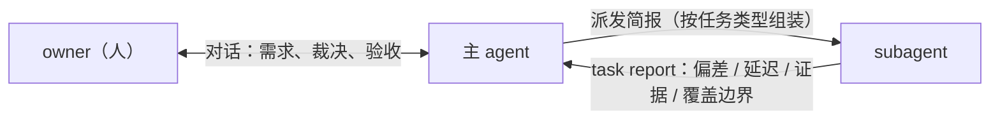
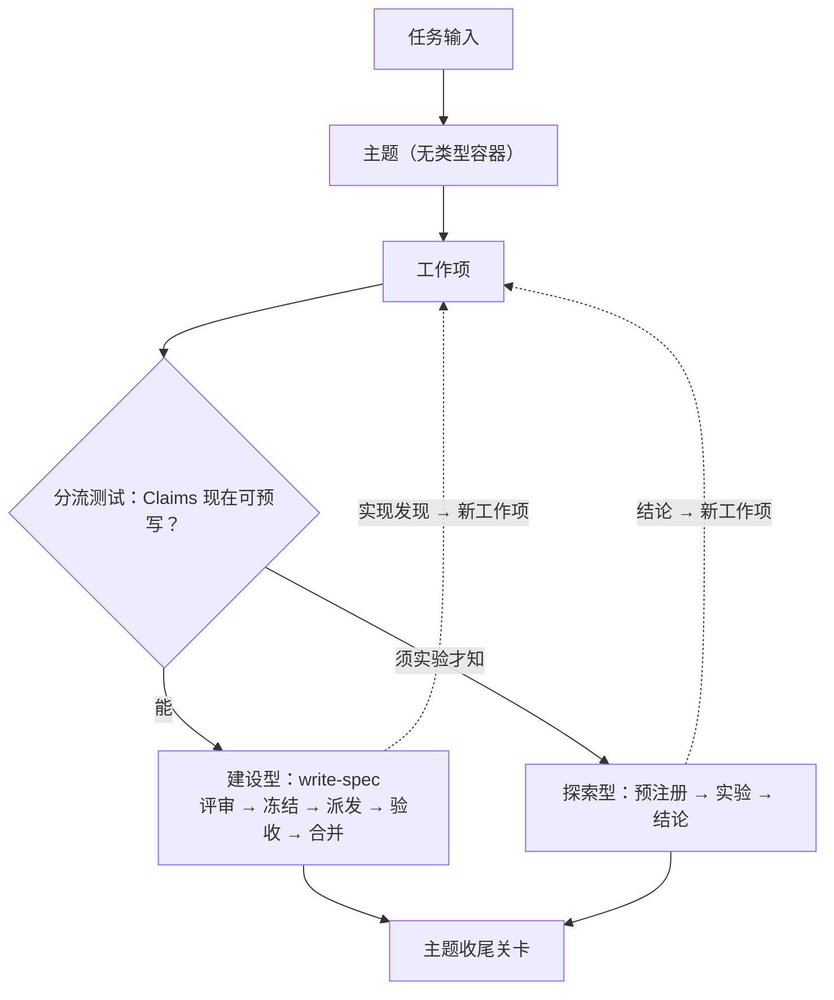
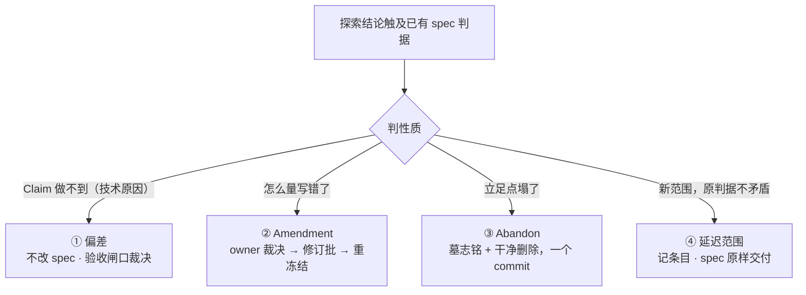
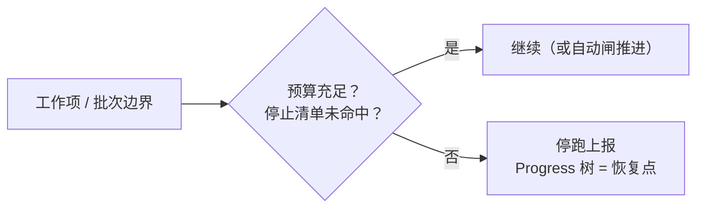
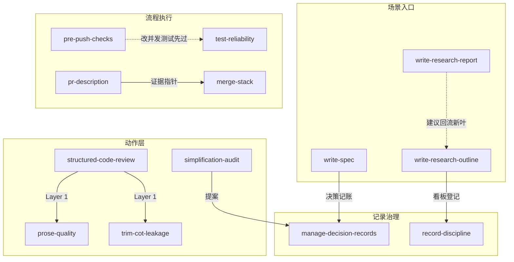
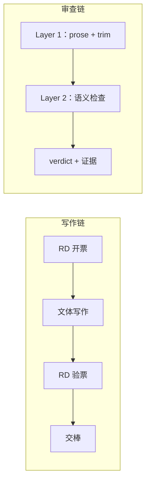
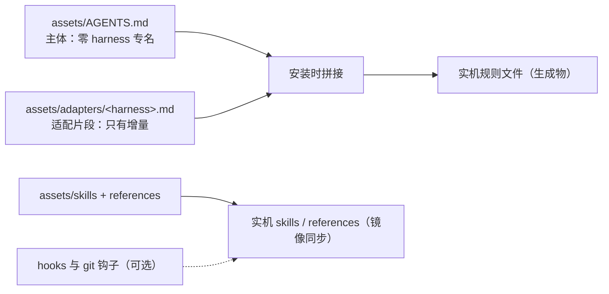

# Spec-Loop Skill

一套**与 AI 协作完成研究与工程任务**的方法论：人定方向与裁决，主 agent 拆解、派发、验收，subagent 实现任务——配一套可跨设备、跨 harness 移植的规则与 skill 语料。

English version: [README.en.md](README.en.md)

## 设计理念

### 分工：三种角色，一条对话主线



- **owner（人）**：定方向、给需求，在关键闸口裁决——spec 冻结、amendment/abandon、验收、主题收尾。
- **主 agent**：与人对话、理解需求、拆解任务、派发、审查与验收；决策、进度、契约、报告的**唯一写者**（agent 内；交付型报告的审阅稿由 owner 裁决，owner 可直接改）。少量修复亲自改，大量修复 resume 原 subagent 继续。
- **subagent**：实现主 agent 派发的任务（大量代码或成篇文字），交付 task report；不写契约与决策工件。

### 六条核心观念

1. **单入口 + 分流测试**——任务不分"工程/研究"。每个工作项单独问一句"Claims 现在可预写吗？"：能（可预写 = 数值有出处——实测 / 标准 / 需求；预测值 = 隐藏预注册）→ 建设型，走 spec 契约；须实验才知 → 探索型，走预注册。
2. **互产循环**——探索结论生成新建设项，实现反常生成新探索项。"边测试边探索"不需要换轨，只需要不断生成新工作项。
3. **判据变更四通道**——冻结的 spec 不是死的：偏差（不改契约）、Amendment（改度量）、Abandon（立足点塌，干净删除）、延迟范围（新范围另记），各有受控出口。
4. **一源多投影**——同一事实多处出现是多读者需求，不是病；病在无规格的复制。每条事实一个权威家，其余位置只放一行投影，且禁止投影的投影。
5. **预注册 = 归因锚**——探索型实验先冻结目标判据与归因设计，"达到/未达"才有因果解释力；FAIL 分析是探索的黄金产出。
6. **渐进式披露 + 强制力四层**——规则分三层按需加载（恒载规则文件 → 事件加载 skill → 引用深潜 references）；强制力分层布置：机械拦截 > 流程结构（闸口/checklist）> 规则文本 > 角色自觉。

### 主循环全景



### 判据变更四通道



### 主题收尾关卡


五项全过才许关门（无人值守未过 = 停机上报）；第 ⑤ 项门禁强制"扫了"不强制"清完"——治理候选记账即可，不阻塞关闭。

### 无人值守与安全网

长跑（无人值守）挂在主题层，四件安全网兜底：

- **预算检查点**：每个工作项 / 批次边界核对剩余预算，不够就停跑上报——绝不降门禁硬跑。
- **停止清单**：改历史、泄密、需用户判断、契约实质变化、真实回归红……命中即停 + 上报。
- **恢复点**：Progress 树是唯一进度真相——一行一节点、状态词可 grep、每个工作项边界必更新，会话中断后从这里续跑。
- **拒绝上限与顾问**：同一评审对象 3 连拒即停；同一目标 3 连败派只读顾问（咨询与处置记一条决策条目）。



## Skill 集（13 个，四层）



**场景入口**——三类写作：

| skill | 职责 | 触发 |
|---|---|---|
| `write-spec` | 契约写作：`[Sn]`/Claims、冻结、After-freeze 变更程序 | 建设型工作项开工；amendment / abandon / 延迟处置 |
| `write-research-outline` | 看板写作（按需物化）、实验预注册、双速登记 | 大纲物化；轻登记；实验前 |
| `write-research-report` | 解释写作：阶段 / 总体 / 深潜三种报告；记录型写一次，交付型审到定稿 | 叶子批次终态；主题收尾；owner 索要正式报告 |

**记录治理**——"一源多投影"的落地：

| skill | 职责 | 触发 |
|---|---|---|
| `manage-decision-records` | 决策治理：条目与 Progress 树格式、supersession、墓志铭、收尾批处理 | 增改决策；amendment 记账；收尾分流 |
| `record-discipline` | 记账结构纪律：源/投影、预算、开票 / 验票 / 批查三程序 | 写任何记录前；审查；收尾；源变更 |

**动作层**——表达与审查标准：

| skill | 职责 | 触发 |
|---|---|---|
| `prose-quality` | 表达标准：完整命题、覆盖义务、去冗余 | 恒在（写/审/修/剪任何文字） |
| `trim-cot-leakage` | 会话痕迹泄漏检测修复（8 类分类） | 审查 / 修复文案 |
| `structured-code-review` | 两层审查方法论、证据要求、派发审 prompt 构成 | 自审 pass；PR / diff / 任务产出 |
| `simplification-audit` | 架构精简：删除维护义务 | owner 要求；主题收尾治理扫描 |

**流程执行**——工程动作把关：

| skill | 职责 | 触发 |
|---|---|---|
| `pre-push-checks` | 推送把关：按改动面选最小检查集，带证据出门 | push / 标记 ready 前 |
| `pr-description` | PR 叙事四节 + 验收最低项（两份清单） | 创建 / 更新 PR |
| `merge-stack` | 合并落盘：依赖序、修复传播、merge-only | 合并 PR / 切片栈 |
| `test-reliability` | 测试可靠性：拓扑建模、原子资源、隔离与 teardown | 并发/资源型测试；flaky 诊断 |

## 如何协作



- **写作链**：动笔前 `record-discipline` 开票（放不放 / 放哪 / 多大 / 源在哪）→ 工件 skill 文体写作 → RD 验票 → 交棒；记录型交棒即终态，交付型交棒后进入 owner 审阅循环，`Status: final` 才定稿；大纲高频登记走轻量通道（登记即完成）。
- **审查链**：`structured-code-review` 是唯一方法论——Layer 1 先过 `prose-quality` + `trim-cot-leakage`，Layer 2 按改动面做语义检查。承载按需：owner 直审文稿、主 agent 审 subagent 代码（写者≠审者）、或派发审。证据硬要求：**prose 不是证据**。
- **变更链**：实现发现触及判据 → 四通道分流 → Amendment / Abandon 的记账与墓志铭归 `manage-decision-records`，清引用归 `trim-cot-leakage`。
- **质量门链**：并发测试先过 `test-reliability` 设计判据 → push 前 `pre-push-checks` 选证据 → `pr-description` 写清两份清单 → `merge-stack` 带 approve + 证据落盘。工程红线：merge-only、禁 rebase / force-push、禁 `--no-verify`；合并后回滚 = owner 裁决的 revert 正向 commit（不改历史，教训随重做 spec 落地）。
- **治理横切**：`simplification-audit` 在主题收尾做治理扫描（候选记账即可，不阻塞关闭），提案走 `manage-decision-records` 的格式与留存判断；独立记录累积超阈值时提请 owner 做知识库精简。

## 适配到你的 harness

语料本身 harness 无关。不同 harness 只差少量文字（能力画像映射、模型池规则、安装路径），拆成独立**适配片段**，安装时与主体拼接——实机规则文件是**生成物，不手维护**。

适配 = 三件事：合成规则文件、镜像 skills 与 references、按需接 hooks。下面给出 Kimi Code 的完整步骤；MiMo Code 见下一节，新 harness 只需新增一个适配片段。



### 迁移到 Kimi Code

前提：Kimi Code 已安装、已登录并连上模型（新建会话能正常对话）。以下命令在仓库根目录执行。

#### 1. 合成规则文件

```sh
mkdir -p ~/.kimi-code
{ cat assets/AGENTS.md; echo; cat assets/adapters/kimi.md; } > ~/.kimi-code/AGENTS.md
```

- 全局规则读 `~/.kimi-code/AGENTS.md`；项目里的 `AGENTS.md` 与它叠加加载，不互相覆盖。
- 实机文件是生成物：改主体或片段后重新合成，不要手改。
- 适配片段只写能力映射、模型池约束、安装路径与 hooks；主循环、派发简报与评审机制都在主体里，所有 harness 共用。

#### 2. skills 与 references（镜像同步）

```sh
mkdir -p ~/.kimi-code/skills ~/.kimi-code/references
cp -r assets/skills/*     ~/.kimi-code/skills/
cp -r assets/references/* ~/.kimi-code/references/
```

- 同步是镜像：以仓库为准，覆盖之外，仓库已移除的内容一并从实机删除（`diff -rq` 可查残留）；非本仓库来源的文件不动。
- skill 名来自 `SKILL.md` 的 frontmatter，不来自目录名。
- references 是深潜层，由规则与 skill 按路径引用，不自动注入上下文。

#### 3. hooks 与 git 钩子（可选）

hooks 是防手滑护栏（fail-open）：**没有 hooks 的 harness 由规则层完整兜底**，方法论不依赖它。三个 hook 是抽象护栏，契约如下（权威定义见 `assets/references/workflow/github-flow.md`「Hook contract」），任何 harness 按自己的扩展点实现：

| hook | 作用点 | 作用方式 | 守护对象 | 失败模式 | 所需能力 |
|---|---|---|---|---|---|
| R1 危险命令拦截 | shell/git 命令执行前 | 命中危险命令（force-push、rebase、`reset --hard`、`--no-verify`）即阻断 | merge-only 红线、停止清单"改历史" | fail-open | 命令执行前的钩子 |
| R2 push 证据提醒 | push 前 | 仅提醒证据要求，不阻断 | "prose 不是证据"、`pre-push-checks` | fail-open | push 前的钩子 |
| R3 L0 站岗 | git pre-commit | 执行产品自定义的 `scripts/run-l0`（L0 分层见 `references/workflow/testing.md`） | L0 机械底座 | 无 L0 定义时跳过并大声警告 | git hooks |

Kimi Code 的参考实现在 `assets/adapters/kimi-hooks/`。R1/R2 装到全局：

```sh
mkdir -p ~/.kimi-code/hooks
cp assets/adapters/kimi-hooks/*.mjs ~/.kimi-code/hooks/
```

把 `assets/adapters/kimi-hooks/config.toml` 里的两个 `[[hooks]]` 块合并进 `~/.kimi-code/config.toml`——不要整文件覆盖，你的 provider / model 配置在同一个文件里。

R3 是普通 git 钩子，装到产品仓库（产品需定义自己的 `scripts/run-l0`）：

```sh
cp .githooks/pre-commit <你的产品仓>/.githooks/
cd <你的产品仓> && git config core.hooksPath .githooks
```

#### 4. 校验

```sh
{ cat assets/AGENTS.md; echo; cat assets/adapters/kimi.md; } | diff -q - ~/.kimi-code/AGENTS.md
find ~/.kimi-code/skills -mindepth 1 -maxdepth 1 -type d | wc -l   # 应为 13
ls ~/.kimi-code/hooks/block-dangerous-git.mjs ~/.kimi-code/hooks/push-evidence-reminder.mjs
```

改完在新会话里验证规则与 skill 已加载。

### 迁移到 MiMo Code

MiMo Code 与 Kimi Code 的差别只在安装位置、agent 名称、模型档位和钩子载体；方法论主体完全共用。以下步骤不绑定具体供应商、模型或机器路径。

#### 1. skills 与 references

```sh
for s in assets/skills/*/; do
  n=$(basename "$s")
  mkdir -p ~/.config/mimocode/skills/"$n"
  cp -r "$s/." ~/.config/mimocode/skills/"$n"/
done
mkdir -p ~/.config/mimocode/references
cp -r assets/references/. ~/.config/mimocode/references/
```

- 保留目标目录里非本仓库来源的个人 skill；镜像只覆盖仓库携带的内容。
- skill 名来自 frontmatter，不来自目录名；重名时后加载的覆盖前一个。
- 默认全局目录会被自动扫描；只有放在别处时才需要在 `mimocode.jsonc` 里写 `skills.paths`。

#### 2. 合成全局规则

```sh
mkdir -p ~/.config/mimocode
{ cat assets/AGENTS.md; echo; cat assets/adapters/mimo.md; } > ~/.config/mimocode/AGENTS.md
```

- 实机文件是生成物，不手改；改主体或片段后重新合成。
- MiMo Code 的**项目级** `AGENTS.md` 与**全局**文件是叠加加载，不是互相遮蔽；`instructions` 配置的额外文件也会合并进来。
- 适配段只写路径、能力映射、模型档位、本地机制与 hooks；主循环、派发简报、评审机制都在主体里，所有 harness 共用。

#### 3. 模型档位

```jsonc
{
  "$schema": "https://mimo.xiaomi.com/mimocode/config.json",
  "model": "standard",
  "model_groups": {
    "lite": "<provider>/<small-model>",
    "standard": "<provider>/<main-model>"
  },
  "agent": {
    "general":    { "model": "lite" },
    "explore":    { "model": "lite" },
    "title":      { "model": "lite" },
    "summary":    { "model": "lite" },
    "compaction": { "model": "lite" }
  }
}
```

- 主 agent 与 `plan` 用顶层 `model`；不写 `agent.build.model` / `agent.plan.model`，保持用户可调。
- 所有 subagent 用低档；约束是 **review ≥ implement**（主 agent 档位不低于被审 subagent）。
- 档位数量与命名按你的模型池调整；不要用旧版 `small_model`，廉价任务走 `lite` 组。
- `mimo run -m <group>` 不解析 group；headless 测试用字面量 `-m <provider>/<model>`。

#### 4. hooks

**R1 危险命令拦截**：全局插件 `~/.config/mimocode/plugin/spec-loop-guard.ts`。

```ts
// R1: block history-rewriting git commands.
// Fail-open: a load or hook failure leaves the rule layer as the guard.
const BANNED: { re: RegExp; why: string }[] = [
  { re: /git\s+push\b[^;&|]*\s(?:--force-with-lease|--force|-f)\b/, why: "force-push is banned (history rewrite)" },
  { re: /git\s+rebase\b/, why: "git rebase is banned (merge-only flow)" },
  { re: /git\s+reset\s+--hard\b/, why: "git reset --hard is banned" },
  { re: /--no-verify\b/, why: "--no-verify is banned" },
]

export default async () => ({
  "tool.execute.before": async (input: any, output: any) => {
    if (input?.tool !== "bash") return
    const command = String(output?.args?.command ?? input?.args?.command ?? "")
    for (const { re, why } of BANNED) {
      if (re.test(command)) throw new Error("Blocked: " + why)
    }
  },
})
```

- 这是 MiMo Code 的未文档化插件面，`--pure` / `MIMOCODE_PURE` 会关闭插件；升级后建议复验。
- 不要直接相信它生效：先临时加一条「命令含某个标记即抛错」，让 agent 执行 `echo <标记> > /tmp/probe-ran`；文件不存在 + 工具返回 Blocked = 钩子触发且抛错能阻断；再跑一条普通命令做负向对照，通过后删掉标记规则。

**R2 push 前证据提醒**：MiMo Code 没有「命令前注入文本」的钩子，由规则层承担——主体 GitHub Flow 节的触发行 + `pre-push-checks` skill；证据落进 `pr-description`。

**R3 L0 提交闸**：每仓库安装，不是全局设置。

```sh
git config core.hooksPath .githooks
```

- 确保 `.githooks/pre-commit` 可执行；产品仓库定义 `scripts/run-l0`（分层见 `references/workflow/testing.md`）。
- 临时仓库三态测试：无 `run-l0` → 告警放行；`run-l0` 退出 1 → commit 被阻断；退出 0 → 通过。

#### 5. 校验

```sh
wc -l ~/.config/mimocode/AGENTS.md          # 建议 ≤ 200
mimo agent list                              # 只剩自带 agent；无自定义覆盖
mimo debug config                            # model / model_groups / agent 覆盖
mimo debug skill                             # 仓库 skill 可见
mimo models <provider>                       # 档位引用的模型 ID 存在
mimo run -m <provider>/<model> "Reply with exactly: ok"
```

#### 6. 常见坑

| 坑 | 处理 |
|---|---|
| 项目有 `AGENTS.md`，以为全局规则不生效 | 两者叠加加载；全局规则仍会加载 |
| 把风格文档同时放进 `instructions` 和 references | 重复注入；只保留 references + 索引 |
| `skills.paths` 写了 `~` | 用绝对路径，或依赖默认全局目录扫描 |
| 自定义 `agent/<name>.md` 与自带同名 | 会覆盖自带 base prompt；删掉即恢复 |
| 自定义 primary agent 的正文 | 会替换模型家族 prompt；环境/技能/instructions 块仍追加 |
| `mimo run -m <group>` | 不解析 group；用字面量 `provider/model` |
| 插件没生效 | `--pure` 会关闭；插件 API 未文档化，升级后复验 |
| `git commit --no-verify` 绕过 R3 | 由 R1 拦；不要 `--no-verify` |
| 改了配置但当前会话没变 | 新会话/重启 TUI 后生效；模型选择是会话级的 |

### 通用校验

```sh
{ cat assets/AGENTS.md; echo; cat assets/adapters/<harness>.md; } | diff -q - ~/.<harness>/AGENTS.md || echo "stale: re-run step 1"
find ~/.<harness>/skills -mindepth 1 -maxdepth 1 -type d | wc -l   # 应为 13
```

## 仓库结构

| 路径 | 作用 |
|---|---|
| `assets/AGENTS.md` | 规则主体（harness 无关；合成迁移的一半） |
| `assets/adapters/` | 每 harness 一个适配片段 + 可选 hooks 脚本 |
| `assets/skills/` | 13 个 skill，每个一个目录一份 `SKILL.md` |
| `assets/references/` | `style/`（风格、工程原则、错误处理）与 `workflow/`（测试法、GitHub Flow） |
| `.githooks/` | R3 pre-commit 钩子参考实现（普通 git 钩子，任何 harness 通用） |
| `README.md` / `README.en.md` | 中英门面（本文件） |
| `CHANGELOG.md` | 版本变更说明与理由（含语言政策） |

语料（`assets/`）用英文维护——单一源语言，跨设备 diff 稳定；README 中文、`README.en.md` 英文。完整语言政策见 [CHANGELOG.md](CHANGELOG.md)。

## 版本与理由

每个版本改了什么、为什么这么改、排除了哪些方案，全部记录在 [CHANGELOG.md](CHANGELOG.md)。
